# 📊 Flujos de Datos y Casos de Uso - GuarinoApp

## Índice
1. [Flujos Principales](#flujos-principales)
2. [Módulos por Rol](#módulos-por-rol)
3. [Casos de Uso Detallados](#casos-de-uso-detallados)
4. [Diagrama de Secuencia](#diagrama-de-secuencia)
5. [Integraciones Externas](#integraciones-externas)

---

## Flujos Principales

### 1️⃣ Flujo de Autenticación

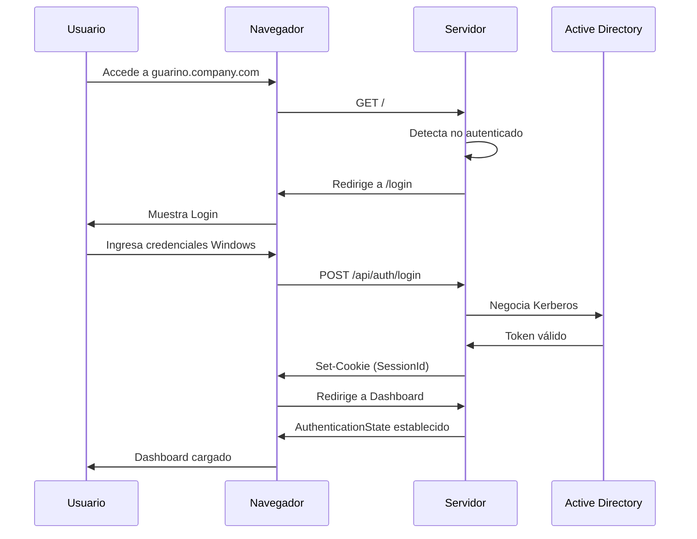

### 2️⃣ Flujo de Consulta de Datos (GetPallets)

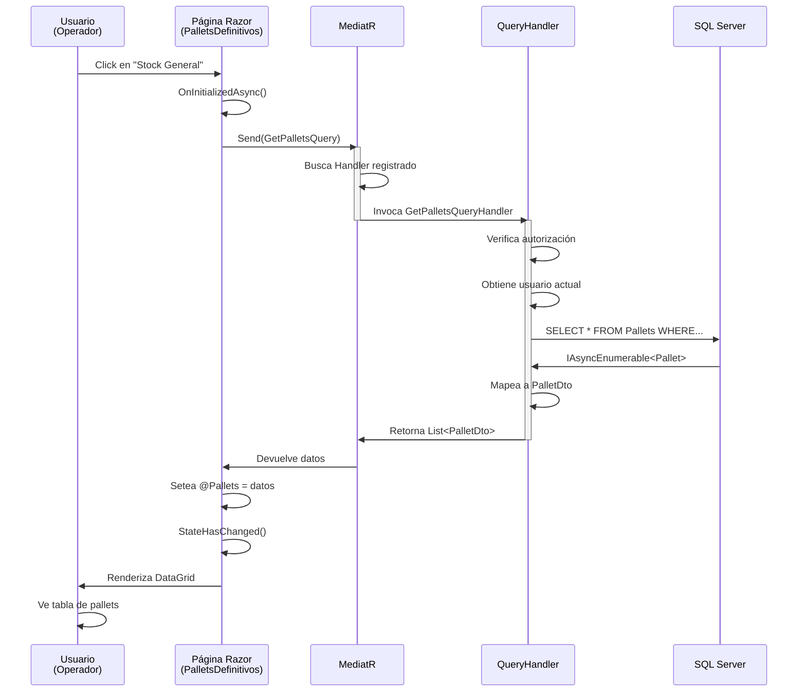

### 3️⃣ Flujo de Creación de Pallet

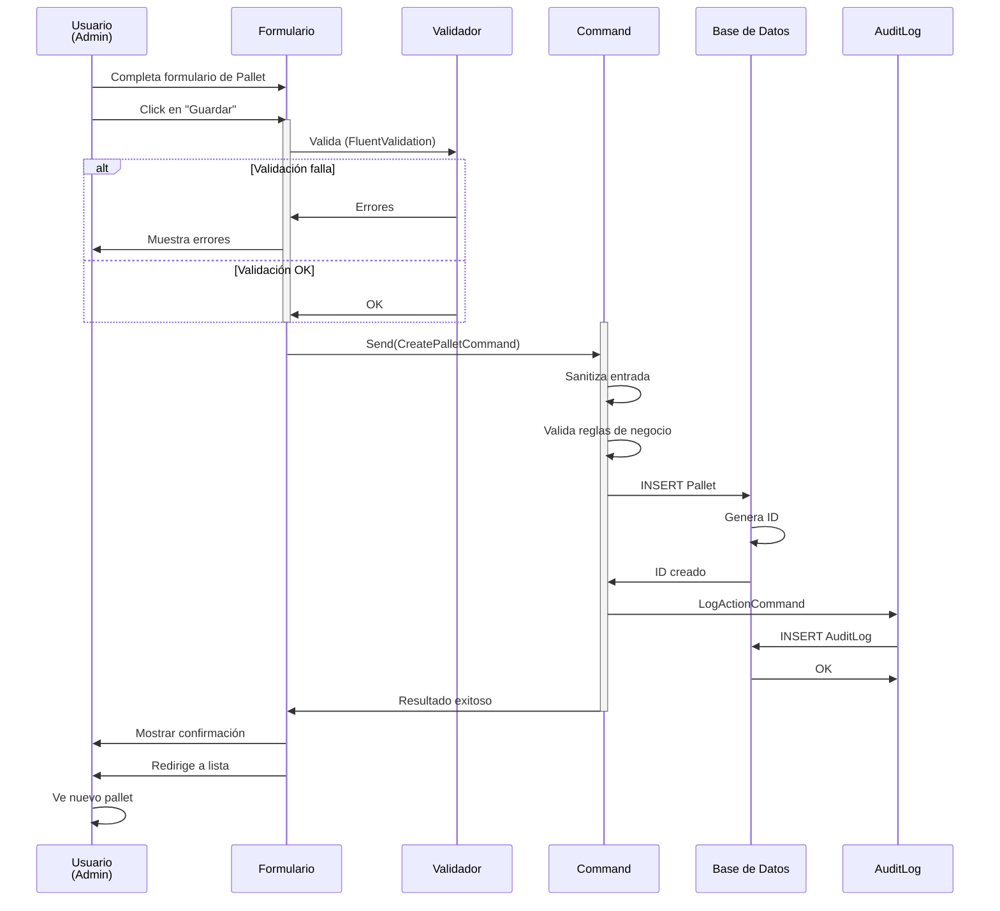

### 4️⃣ Flujo de Monitoreo Climático (Hosted Service)

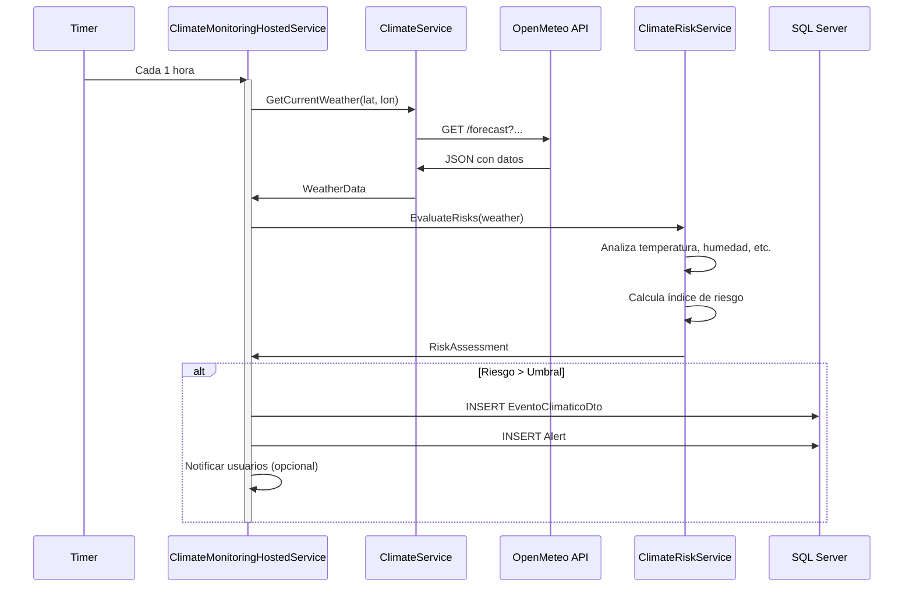

### 5️⃣ Flujo de Exportación a Excel

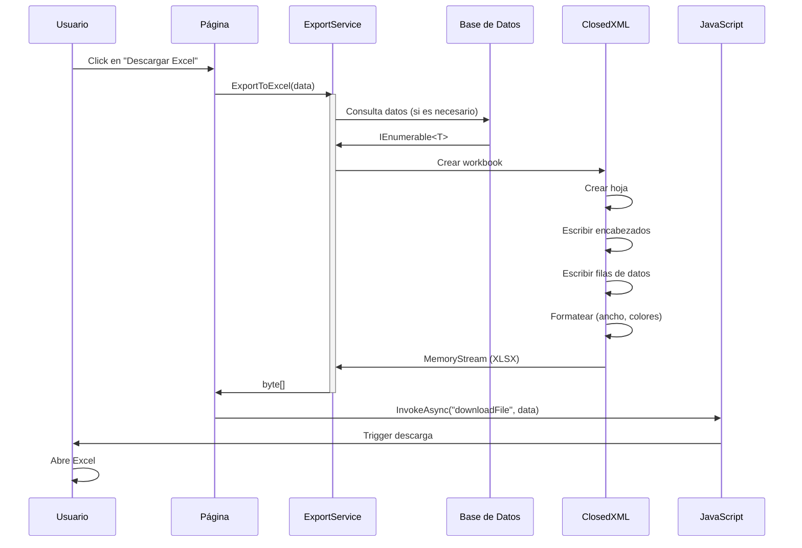

---

## Módulos por Rol

### 👨‍💼 Admin (Acceso Total)

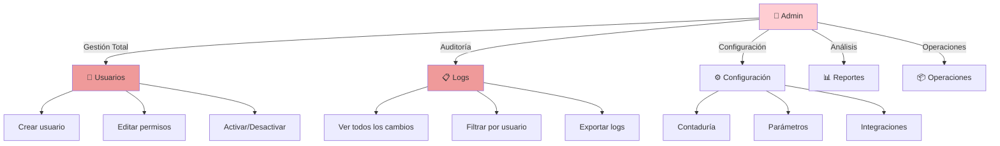

### 👔 Gerencia (Ejecutiva)

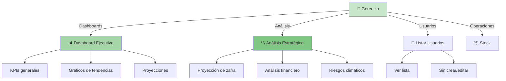

### 💰 Contador (Finanzas)

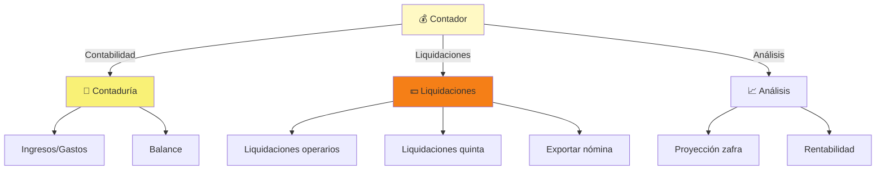

### 👷 Operador (Operativo)

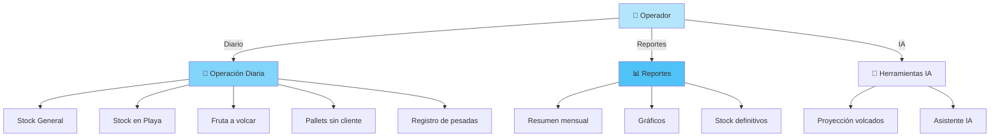

---

## Casos de Uso Detallados

### UC-001: Consultar Stock de Pallets

**Actor**: Operador  
**Precondiciones**: Usuario autenticado con rol Operador  
**Flujo Básico**:

1. Actor navega a `/stockgeneral`
2. Sistema carga datos de BD
3. Presenta tabla con filtros
4. Actor aplica filtros (cliente, fecha, etc.)
5. Sistema re-consulta y actualiza tabla
6. Actor selecciona un pallet
7. Sistema muestra detalles
8. Actor cierra detalles o exporta

**Flujo Alternativo - Sin datos**:
- Si BD vacía: mostrar mensaje "No hay datos"

**Flujo Alternativo - Error BD**:
- Si error SQL: mostrar error genérico y loguear

**Postcondiciones**:
- Datos consultados quedan en log de auditoría
- Sin modificaciones en BD

### UC-002: Crear Usuario

**Actor**: Admin  
**Precondiciones**: Usuario Admin autenticado  
**Flujo Básico**:

1. Actor navega a `/usuarios`
2. Sistema carga lista de usuarios
3. Actor click en "Nuevo usuario"
4. Sistema abre diálogo
5. Actor completa:
   - Email (validado)
   - Nombre
   - Roles (checkboxes)
6. Actor click en "Guardar"
7. Sistema valida datos
8. Sistema crea usuario en BD
9. Sistema genera contraseña temporal
10. Sistema envía email con credenciales
11. Retorna a lista

**Validaciones**:
- Email única
- Email válido
- Al menos 1 rol
- Nombre no vacío

**Postcondiciones**:
- Usuario creado en BD
- Email enviado
- Evento en auditoría
- Notificación a usuario Admin

### UC-003: Generar Proyección de Zafra

**Actor**: Gerencia/Admin  
**Precondiciones**:
- Usuario autenticado
- Datos históricos de al menos 2 años
- OpenMeteo disponible  
**Flujo Básico**:

1. Actor navega a `/proyeccion-zafra`
2. Sistema carga datos históricos
3. Actor selecciona escenarios
   - Optimista
   - Probable
   - Pesimista
4. Sistema consulta Ollama para análisis IA
5. Sistema analiza:
   - Tendencias históricas
   - Proyecciones climáticas
   - Factores económicos
6. Sistema genera reportes con:
   - Gráficos
   - Tablas de datos
   - Recomendaciones
7. Actor puede exportar o enviar por email

**Postcondiciones**:
- Proyección guardada en BD
- Auditoría registrada
- Email enviado si solicita

### UC-004: Monitorar Riesgos Climáticos

**Actor**: Sistema (Hosted Service)  
**Precondiciones**: Nada  
**Flujo Básico**:

1. Cada hora se ejecuta ClimateMonitoringHostedService
2. Consulta coordenadas de cultivos
3. Llama a OpenMeteo API
4. Evalúa:
   - Temperatura (> 35°C?)
   - Humedad (< 30%?)
   - Lluvia inesperada
   - Helada (< 0°C?)
5. Si hay riesgo:
   - Crea EventoClimaticoDto
   - Crea AlertaDto
   - Notifica usuarios Gerencia/Admin
6. Registra evento en BD

**Postcondiciones**:
- Evento guardado
- Usuarios notificados si aplica

### UC-005: Exportar Datos a Excel

**Actor**: Operador/Gerencia  
**Precondiciones**: Usuario autenticado, datos disponibles  
**Flujo Básico**:

1. Actor está en página de reportes
2. Actor click en "Descargar Excel"
3. Sistema:
   - Consulta BD según filtros
   - Genera XLSX con ClosedXML
   - Formatea colores, ancho de columnas
   - Calcula totales si aplica
4. Sistema dispara descarga en navegador
5. Actor recibe archivo

**Postcondiciones**:
- Descarga registrada en logs
- Auditoría sin detalles de datos (privacidad)

---

## Diagrama de Secuencia

### Integración Completa: Usuario consulta Pallets y Exporta

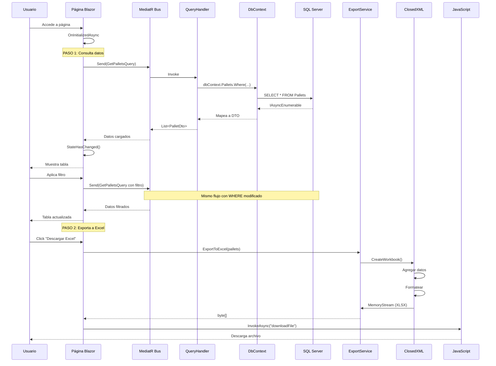

---

## Integraciones Externas

### 🌍 OpenMeteo API

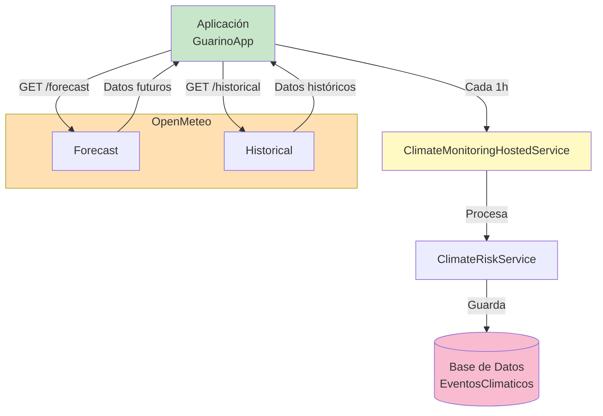

**Endpoint Utilizado**:
```
GET https://api.open-meteo.com/v1/forecast
?latitude=...&longitude=...
&hourly=temperature_2m,relative_humidity_2m,precipitation
&timezone=America/Montevideo
```

**Datos Consultados**:
- Temperatura (°C)
- Humedad relativa (%)
- Precipitación (mm)
- Velocidad del viento (km/h)

### 🤖 Ollama API

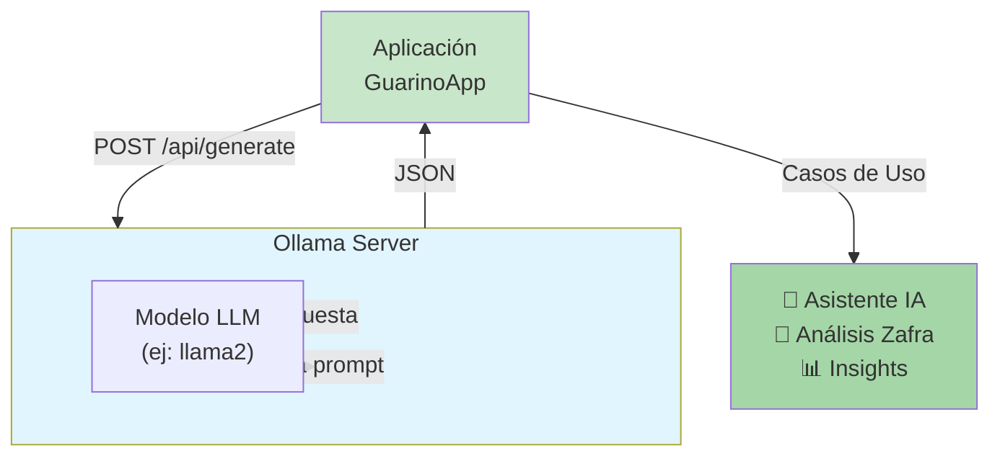

**Endpoint**:
```
POST http://localhost:11434/api/generate
{
  "model": "llama2",
  "prompt": "Análisis de proyección de zafra...",
  "stream": false
}
```

**Casos de Uso**:
- Análisis de Proyección de Zafra
- Generación de planes de mitigación
- Chat asistente general
- Análisis de datos

### 📧 Servicio de Email

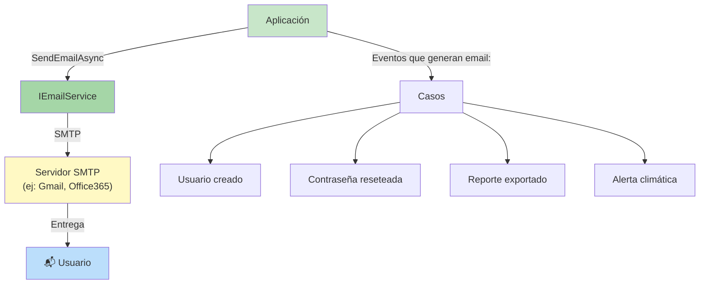

**Configuración** (appsettings.json):
```json
{
  "Email": {
    "SmtpServer": "smtp.gmail.com",
    "SmtpPort": 587,
    "FromEmail": "reportes@guarinoapp.com",
    "SmtpUser": "(usuario SMTP autenticado)",
    "Password": "(contraseña de aplicación)"
  }
}
```

> Los reportes automáticos de operación para el administrador (sección
> `Notificaciones`) usan esta misma configuración SMTP.

---

**Última actualización**: 2024-01-XX  
**Versión**: 1.0
---

## Actualizaciones recientes (Oct 2026)

Cambios aplicados al código y reflejados en la documentación:

- **Filtro de módulos por rol (UI)**: `NavMenu.razor` y `Index.razor` muestran los módulos bloqueados con candado y tooltip "Requiere: X — tu rol actual: Y" en lugar de ocultarlos. Componentes nuevos: `Shared/NavLinkSeguro.razor` y `Shared/EnlaceSeguro.razor`. Matriz de acceso por reflexión en `Services/MapaAccesosRutas.cs` (lee `[Authorize]` de las páginas → ruta→ roles). Helper `Services/RolUsuario.cs` resuelve el rol actual con `RoleNames`. Registrado como singleton en `Program.cs`.
- **RoleNames como fuente única**: constantes `Admin`/`Gerencia`/`Contador`/`Operador` + grupos `Todos`/`Financieros`/`Administracion` + cadenas `*Autorizacion` para `[Authorize]`. Cero literales de rol en `.razor`.
- **Paginación fija de 25 filas** en las 30 grillas (`RowsPerPage="25"` + `MudTablePager PageSizeOptions="new int[] { 25 }"`). Auditoría usa paginación server-side (`ServerData` + `state.Page/PageSize`).
- **Filtro IA por rol**: `ConsultaIArestringida` (log) + matriz de roles por tool MCP.
- **Servidor MCP** (`/mcp`) con `WithHttpTransport()` + middleware Bearer propio (`McpAuthMiddleware`); tools solo lectura; auditoría `McpCall`.
- **Cero datos inventados**: `GetDummyData`/`GenerarZafrasDummy`/fallbacks eliminados; `EsDummy` siempre `false`; "En nuestro poder" = sin cliente y Estado != Bajado/Despachado.
- **Autenticación**: Negotiate + Data Protection tokens (`GuarinoApp.Auth.v1`, 12 h, localStorage `auth_token`); lockout 5 fallos/15 min.
- **Grillas sin paginador** reemplazado por paginación de 25 (instrucción vigente).
- **Build**: 0 errores / 0 advertencias. UI en español.
- **Diagramas Mermaid**: 40 bloques en `docs/diagramas.md` y otros archivos (arquitectura, flujos, seguridad, servicios). Renderizan en GitHub, VS Code (con extensión), Obsidian.
- **Wiki de usuario**: `docs/WIKI_USUARIO.md` con manual funcional por módulo y rol.
- **Auditoría exhaustiva**: `docs/auditoria-exhaustiva.md` (OWASP + UX + deuda técnica).
- **Documentación inversa**: `docs/documentacion-inversa.md` (arquitectura, módulos, decisiones, trampas).