# Manual de usuario - GuarinoApp

Bienvenido al manual de usuario de **GuarinoApp**, el sistema de gestión de operaciones citrícolas. Esta guía explica cómo usar cada módulo de la aplicación, paso a paso, con capturas de pantalla.

---

## 1. Acceso al sistema

### 1.1 Iniciar sesión

1. Abre la aplicación en el navegador (ejemplo: `http://guarino.company.com`).
2. Se mostrará la pantalla de **Ingresar**.
3. Ingresa tu **Usuario** y **Contraseña**.
4. Pulsa el botón **INGRESAR** (o presiona Enter).

> **Nota**: Tras 5 intentos fallidos, la cuenta se bloquea por 15 minutos.

### 1.2 Roles y permisos

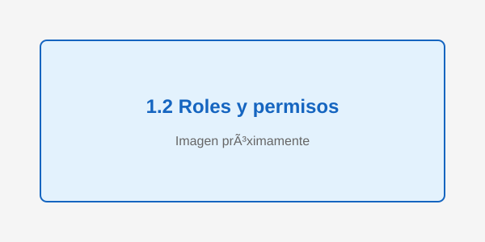

Cada usuario tiene un rol que determina qué módulos puede ver y usar:

| Rol | Qué puede hacer |
|---|---|
| **Admin** | Todo: usuarios, contactos, auditoría, contaduría, gerencia, operaciones. |
| **Gerencia** | Indicadores, proyecciones, reportes, stock, operaciones. |
| **Contador** | Reportes, liquidaciones, contaduría, resúmenes, proyecciones. |
| **Operador** | Operaciones diarias: stock, pesadas, empaque, lotes, fruta a volcar, pallets. |

### 1.3 Menú e Inicio filtrados por rol

- En el **menú lateral** y en **Inicio**, los módulos que tu rol no permite se muestran **bloqueados** con un candado y un mensaje: "Requiere: [rol] - tu rol actual: [tu rol]".
- Si haces clic en uno bloqueado, **no se abre** (la pantalla no cambia).
- La seguridad real la impone el servidor: aunque intentes acceder por URL directa, el sistema denegará el acceso.

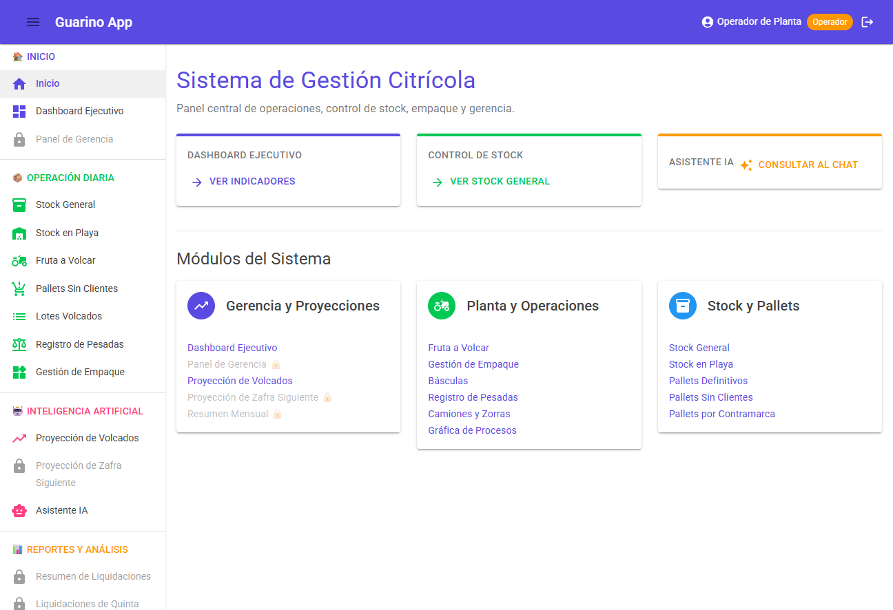

---

## 2. Navegación general

### 2.1 Menú lateral

El menú lateral (izquierda) organiza los módulos por categorías:

- **INICIO**: Inicio, Dashboard Ejecutivo, Panel de Gerencia
- **OPERACIÓN DIARIA**: Stock General, Stock en Playa, Fruta a Volcar, Pallets Sin Clientes, Lotes Volcados, Registro de Pesadas, Gestión de Empaque
- **INTELIGENCIA ARTIFICIAL**: Proyección de Volcados, Proyección de Zafra Siguiente, Asistente IA
- **REPORTES Y ANÁLISIS**: Resumen de Liquidaciones, Liquidaciones de Quinta, Stock de Pallets Sin Cliente, Resumen Mensual, Gráfica de Procesos, Pallets por Contramarca, Pallets Definitivos, Gestión de Riesgos Climáticos
- **LOGÍSTICA Y RECURSOS**: Transportistas, Camiones y Zorras, Lugares de Origen y Destino, Básculas
- **COMERCIAL**: Contactos
- **ADMINISTRACIÓN**: Contaduría, Usuarios, Auditoría
- **DOCUMENTACIÓN**: Wiki (este manual)

### 2.2 Paginación

Todas las grillas (tablas) muestran **25 filas por página**.

- Usa los botones anterior/siguiente en el pie de la tabla para navegar.
- El pie muestra: "Mostrando X-Y de Z registros".

### 2.3 Exportar datos

1. En cualquier grilla, busca la barra **ExportToolbar** (arriba de la tabla).
2. Pulsa el botón del formato deseado: **PDF**, **Excel** o **CSV**.
3. El archivo se descarga automáticamente.

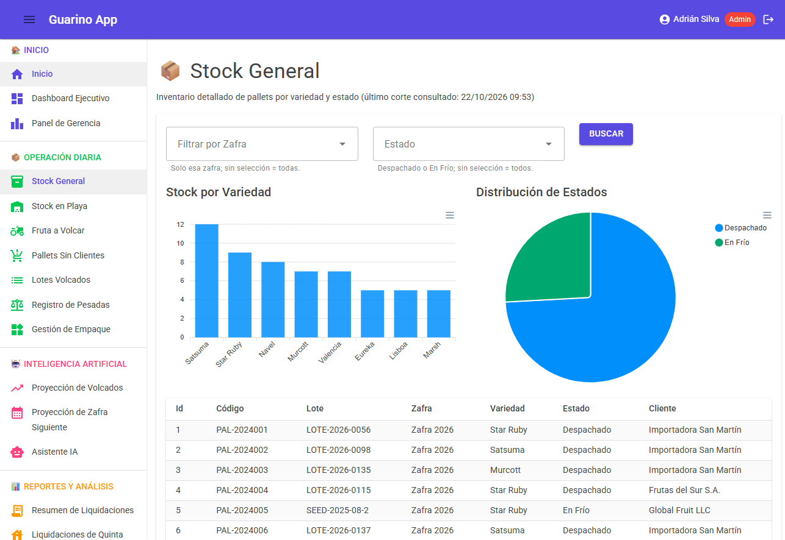

### 2.4 Filtrar datos

1. Usa los selectores de filtro (Variedad, Productor, etc.) en la barra de filtros.
2. Al cambiar un valor, la grilla se actualiza automáticamente.
3. Para limpiar un filtro, selecciona la opción vacía.

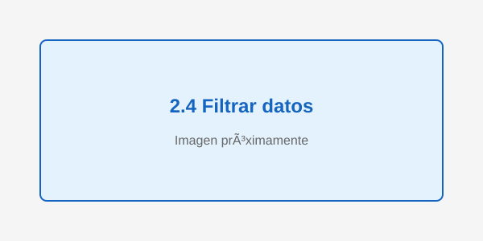

---

## 3. Módulos principales

### 3.1 Inicio

Pantalla principal con accesos rápidos a los módulos disponibles según tu rol.

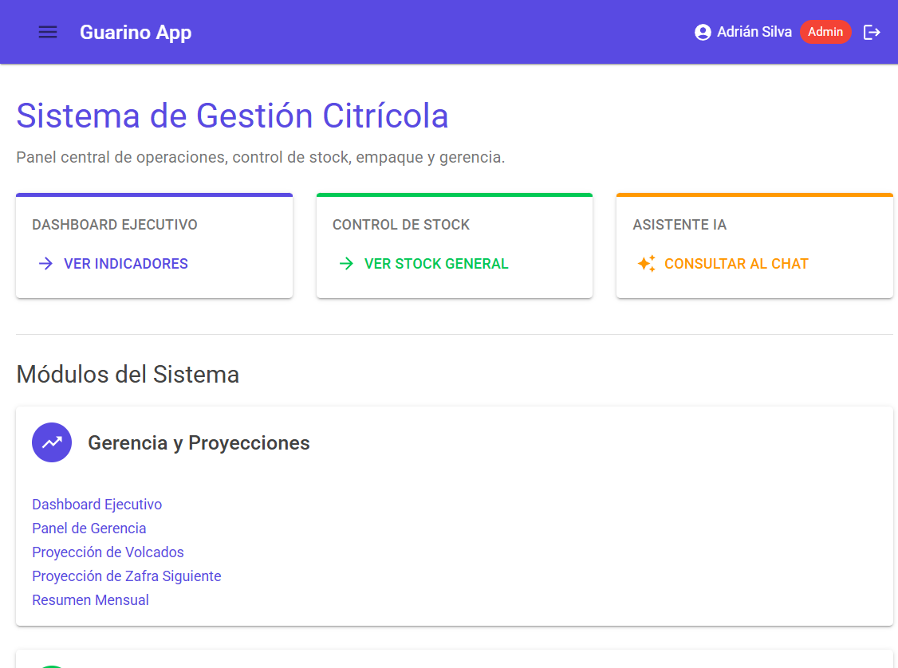

### 3.2 Dashboard Ejecutivo

Muestra KPIs clave de la zafra: kilos, bins, pallets, tendencias.

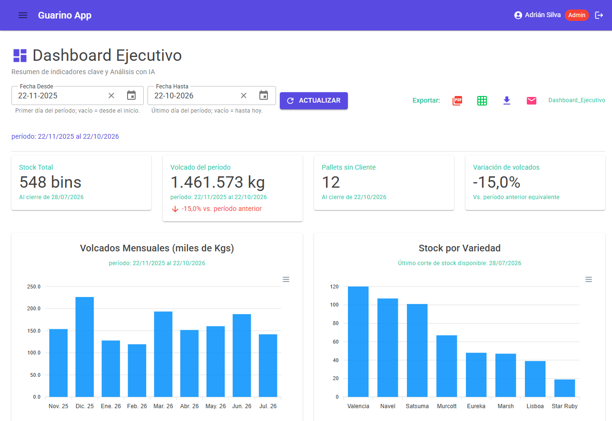

### 3.3 Stock General

Lista de pallets por variedad, estado y zafra.

**Cómo usarlo:**
1. Selecciona una **Zafra** del filtro (opcional).
2. Selecciona un **Estado** (opcional): En Frío, Despachado, etc.
3. La grilla muestra los pallets que cumplen los filtros.
4. Usa la paginación para navegar.
5. Exporta con los botones PDF/Excel/CSV.

### 3.4 Stock en Playa

Pallets en playa (sin cliente asignado), agrupados por variedad.

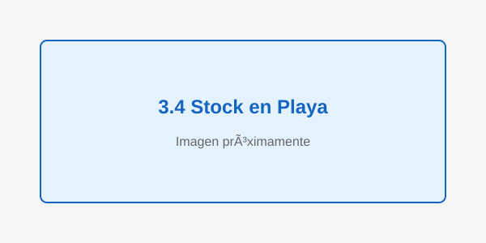

### 3.5 Fruta a Volcar

Fruta pendiente de volcar por lote y productor.

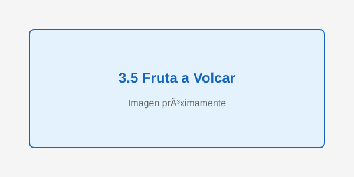

### 3.6 Lotes Volcados

Lotes volcados agrupados por lote y fecha.

**Cómo usarlo:**
1. Ajusta el rango de fechas (por defecto: últimos 3 meses).
2. Filtra por **Variedad** o **Productor** (opcional).
3. La grilla muestra los lotes volcados que cumplen los filtros.
4. Exporta si necesitas.

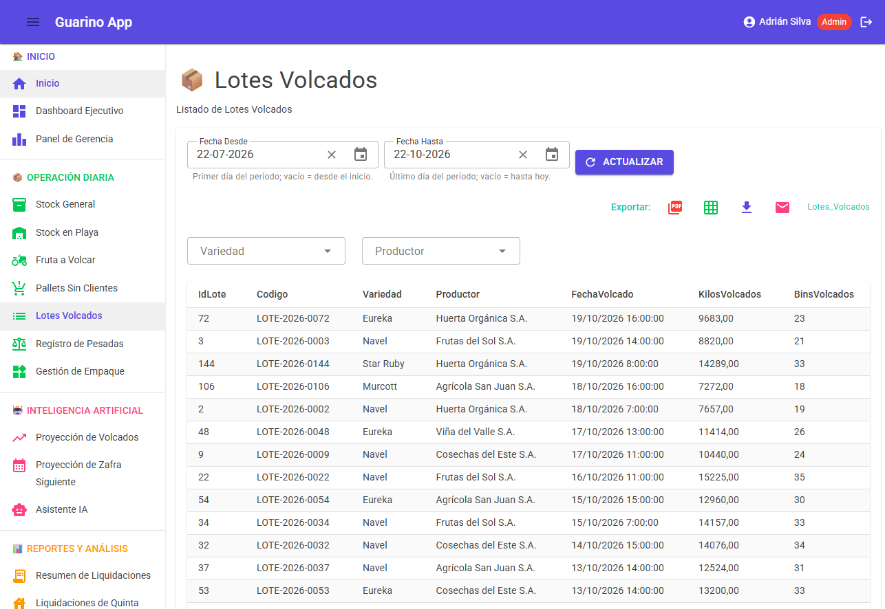

### 3.7 Registro de Pesadas

Registro de pesadas (fuente: LotesEmboquille).

**Cómo usarlo:**
1. Ajusta el rango de fechas (por defecto: últimos 3 meses).
2. Navega con la paginación (25 por página).
3. Exporta si necesitas.

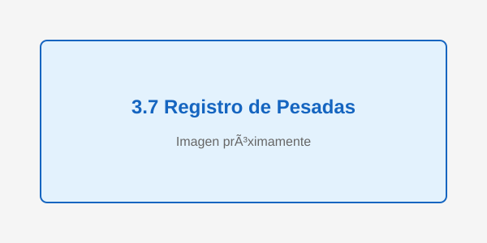

### 3.8 Gestión de Empaque

Catálogo y gestión de empaque.

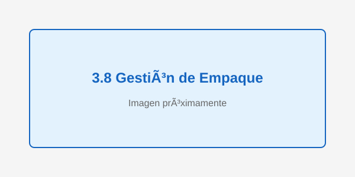

### 3.9 Pallets por Contramarca / Definitivos / Sin Clientes

Vistas especializadas de pallets según su estado.

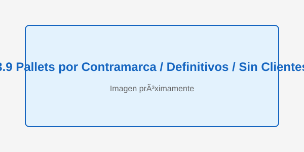

### 3.10 Gestión de Riesgos Climáticos

Mapa interactivo de lotes con eventos climáticos.

**Cómo usarlo:**
1. El mapa muestra lotes con marcadores de riesgo.
2. Haz clic en un marcador para ver detalles.
3. Usa el botón **"Ver en la tabla"** para filtrar la tabla por ese lote.
4. Los KPIs muestran el total exacto (no solo los visibles en la tabla).

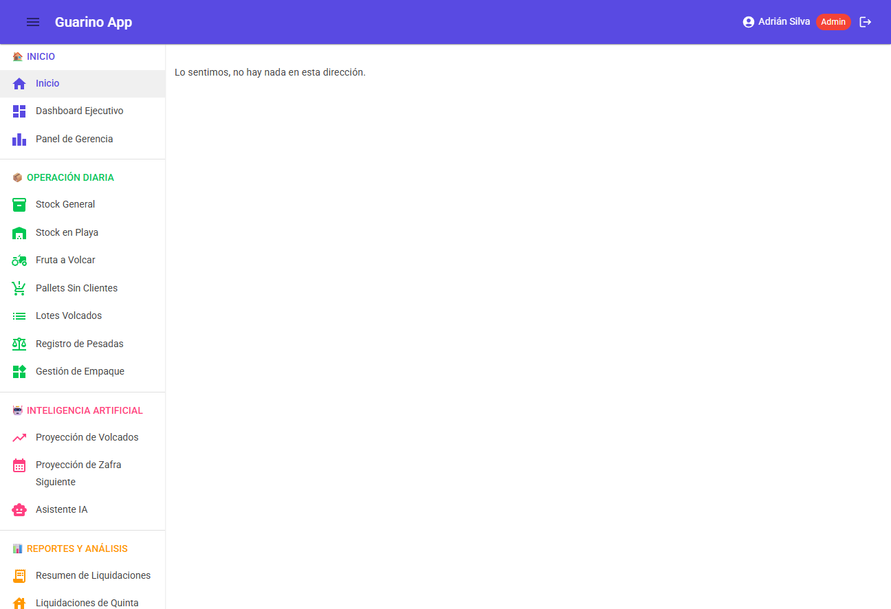

### 3.11 Asistente IA

Consultas de inteligencia artificial seleccionables según tu rol.

**Cómo usarlo:**
1. Selecciona una consulta del catálogo (disponible según tu rol).
2. Pulsa **Ejecutar**.
3. Espera la respuesta (hasta ~12 segundos para análisis de Contaduría).

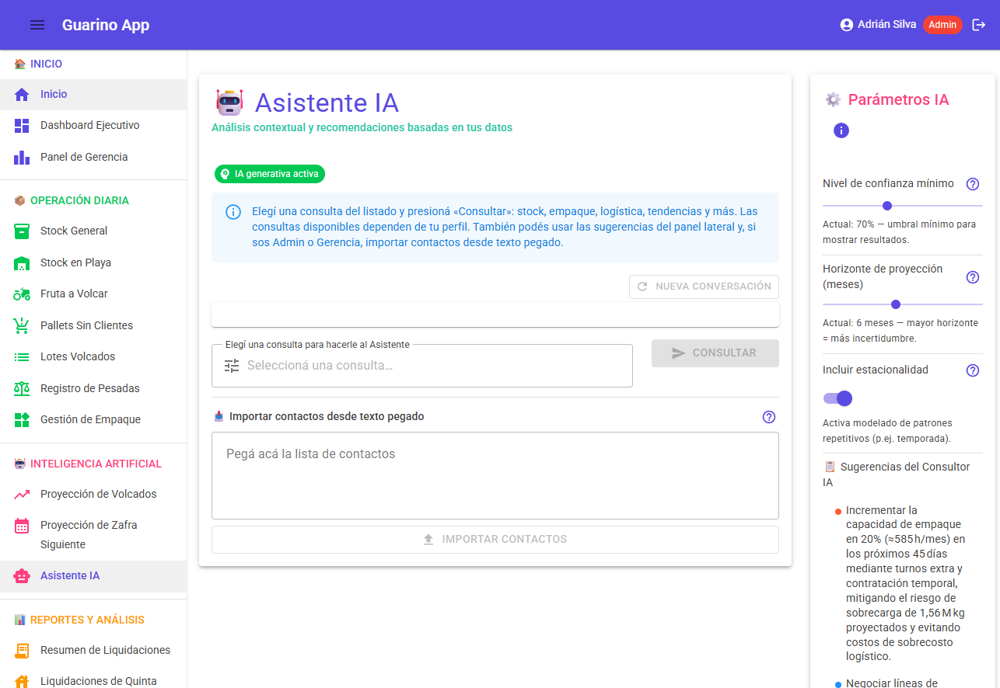

### 3.12 Proyección de Volcados / Zafra Siguiente

Proyecciones de volcados futuros y de la próxima zafra.

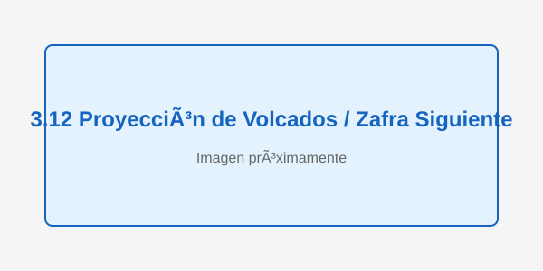

### 3.13 Reportes

- **Resumen de Liquidaciones**: resumen de liquidaciones.
- **Liquidaciones de Quinta**: liquidaciones por quinta.
- **Resumen Mensual**: resumen mensual.
- **Gráfica de Procesos**: gráfica de procesos.

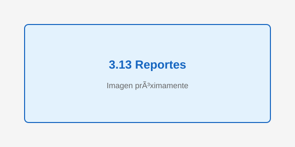

### 3.14 Logística y Recursos

- **Transportistas**: catálogo de transportistas.
- **Camiones y Zorras**: catálogo de camiones y zorras.
- **Lugares**: catálogo de lugares de origen y destino.
- **Básculas**: catálogo de básculas.

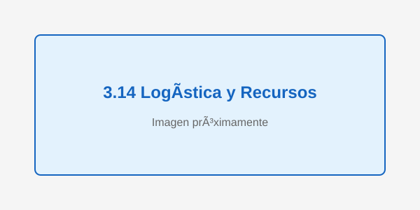

### 3.15 Contactos (solo Administración)

Gestión de contactos con importación masiva.

**Crear un contacto:**
1. Pulsa **NUEVO CONTACTO**.
2. Completa: Nombre, Empresa, Correo, Teléfono.
3. Pulsa **GUARDAR**.

**Importar contactos:**
1. Pulsa **IMPORTAR**.
2. Selecciona un archivo CSV.
3. Revisa la vista previa.
4. Pulsa **IMPORTAR**.

> Validación: correo con formato válido, teléfono de 8 a 15 dígitos.

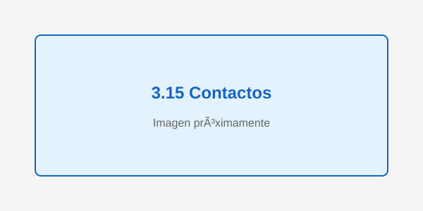

### 3.16 Usuarios (solo Administración)

**Crear un usuario:**
1. Pulsa **NUEVO USUARIO**.
2. Completa: Usuario (mínimo 3 caracteres), Nombre completo, Correo (opcional), Contraseña (mínimo 6 caracteres), Rol.
3. Pulsa **CREAR USUARIO**.
4. Si hay error, se muestra un mensaje rojo y el formulario permanece abierto.
5. En éxito: mensaje verde "Usuario creado correctamente." y la grilla se actualiza.

**Desactivar un usuario:**
1. Busca la fila del usuario en la grilla.
2. Desactiva el switch **Activo**.

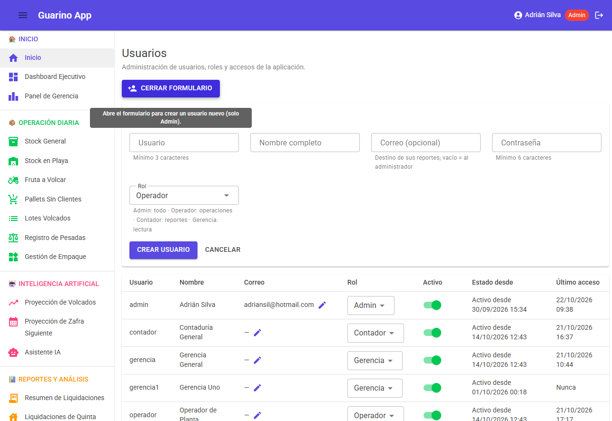

### 3.17 Contaduría (solo Financieros)

Datos financieros + contexto operativo. El Asistente IA puede analizar los datos (tarda ~12 segundos).

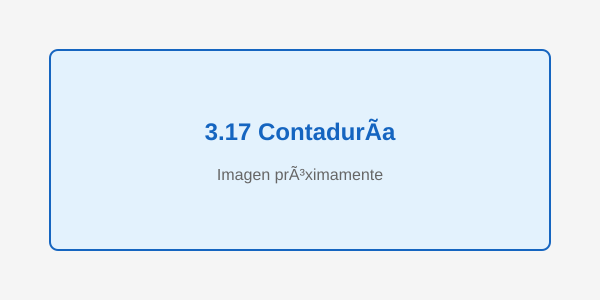

### 3.18 Gerencia (solo Administración)

Indicadores de gerencia.

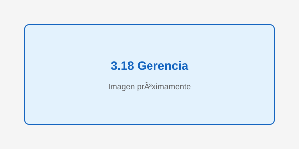

### 3.19 Auditoría (solo Administración)

Log de todas las acciones del sistema.

**Cómo usarlo:**
1. Filtra por **Usuario**, **Acción**, **Módulo** o **Rango de fechas**.
2. La grilla muestra las acciones que cumplen los filtros.
3. Exporta si necesitas.

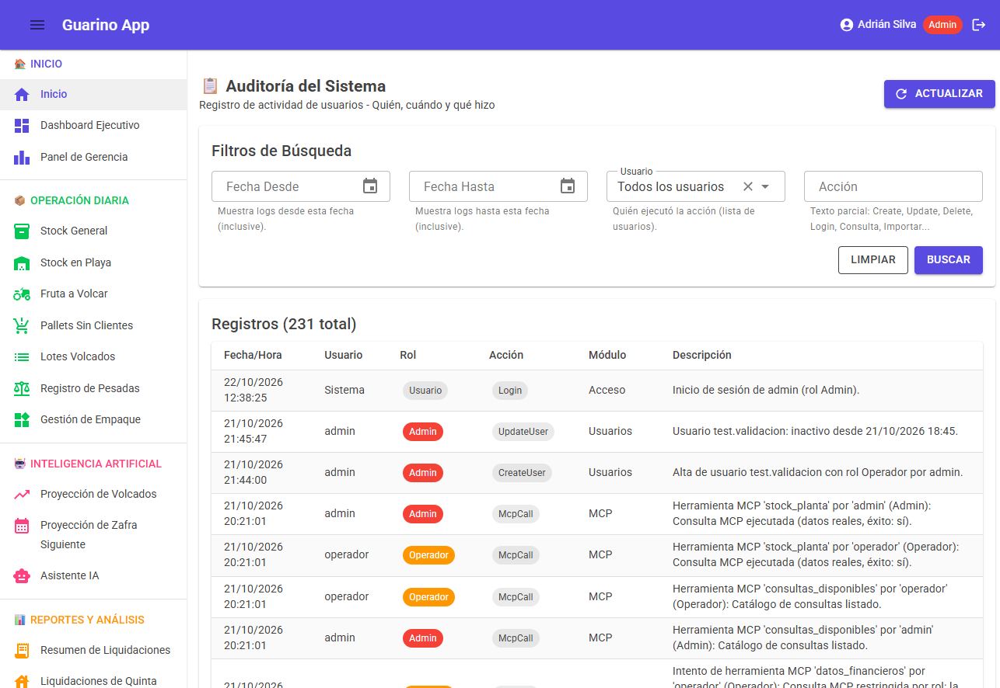

### 3.20 Costo por kg exportable (solo Administración y Contaduría)

Permite ingresar el desglose de costos para saber cuánto cuesta realmente dejar un kg de fruta listo para exportar.

**Cómo usarlo:**
1. Ingresa la **Zafra** a la que aplica el desglose.
2. Completa cada rubro: Fruta puesta en planta, Packing (mano de obra), Cartón y envases, Energía y frío, Flete y puerto, Otros costos.
3. Ingresa los **Kg exportables proyectados** (base para calcular el costo unitario).
4. Pulsa **Guardar desglose**.

El sistema calcula automáticamente el costo total y el **costo por kg exportable**, que se usa en los tableros de Capital de Trabajo y Brecha de Caja de Proyección de Zafra.

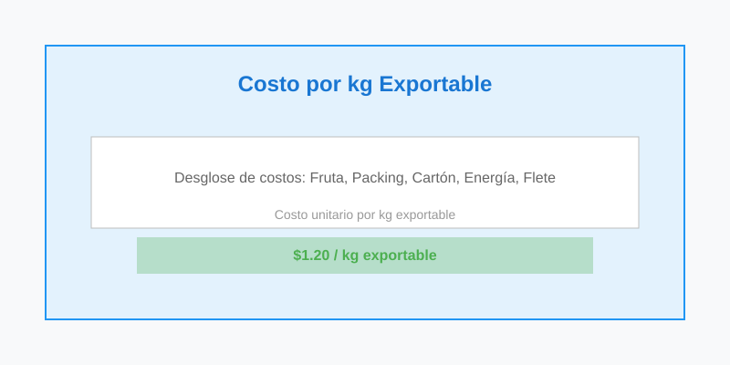

### 3.21 Rendimiento de Packing (solo Administración y Contaduría)

Muestra de cada 100 kg volcados, cuántos terminan en exportación, mercado interno y descarte.

**Cómo se clasifican los pallets:**
- **Exportable:** pallet con cliente asignado y categoría "Export" o estado distinto a "Bajado".
- **Mercado interno:** pallet con cliente nacional, categoría "Primera", sin exportar.
- **Descarte:** pallet con estado "Bajado" o categoría "Descarte".

La pantalla muestra KPIs totales y una tabla detallada por variedad y productor.

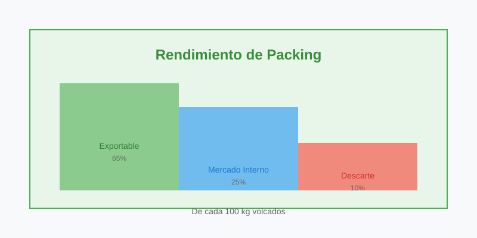

### 3.22 Comparativa Interzafra Semanal (solo Administración y Contaduría)

Compara la zafra en curso contra la zafra anterior, **semana a semana, misma fecha**. Los valores son acumulados: cada semana suma los volcados de las semanas previas.

**Cómo usarlo:**
1. Selecciona al menos dos zafras para comparar (marca los checkboxes).
2. La tabla muestra los volcados acumulados por semana para cada zafra seleccionada.
3. Si tu zafra está por encima de la anterior, vas **adelantado**. Si está por debajo, vas **atrasado**.

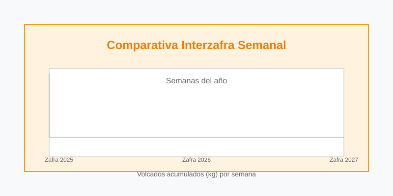

### 3.23 Proyección de Caja a 13 Semanas (solo Administración y Contaduría)

Muestra la "película" de tu caja: entradas y salidas semanales proyectadas para las próximas 13 semanas, por escenario (Base, Pesimista, Optimista).

**Cómo usarlo:**
1. Selecciona el **Escenario** (Base, Pesimista o Optimista).
2. Revisa el saldo inicial, el saldo mínimo (piso de caja) y la semana en que se toca el piso.
3. La tabla semanal muestra entradas y salidas desglosadas (liquidaciones a quintas, jornales, fletes, impuestos).
4. Si el saldo acumulado toca negativo en alguna semana, hay una **brecha de caja** que debes cubrir con financiamiento antes de que llegue ese momento.

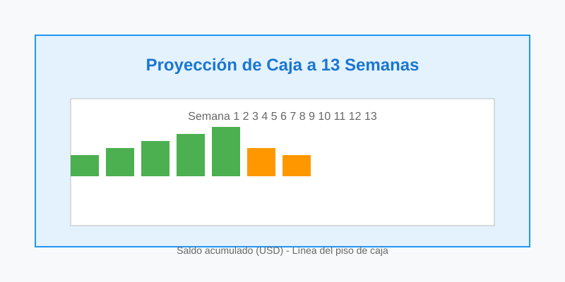

---

## 4. Preguntas frecuentes

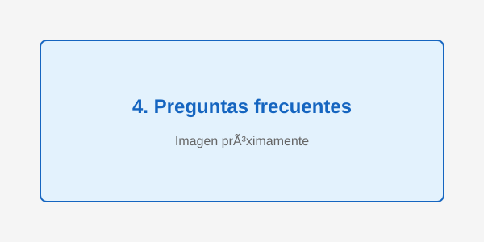

**No veo un módulo en el menú?**
Tu rol no tiene acceso. Los módulos bloqueados se muestran con candado. Contacta al administrador si necesitas acceso.

**La grilla tarda mucho en cargar?**
Algunas páginas (Contaduría, Dashboard) ejecutan análisis pesados. Espera a que aparezca el indicador de carga.

**Cómo cambio mi contraseña?**
Contacta al administrador. El sistema no permite cambio de contraseña por el usuario.

**Los números no coinciden con lo que espero?**
Todas las cifras se calculan directamente de la base de datos. Verifica los filtros de fecha y variedad/productor.

---

*Manual de usuario de GuarinoApp. Última actualización: Octubre 2026.*
