# Diagramas de arquitectura y flujo — GuarinoApp

> Todos los diagramas están en formato **Mermaid** (renderizan en GitHub, VS Code, Obsidian y la mayoría de wikis). Pueden copiarse a cualquier `.md`.

---

## 1. Arquitectura de capas

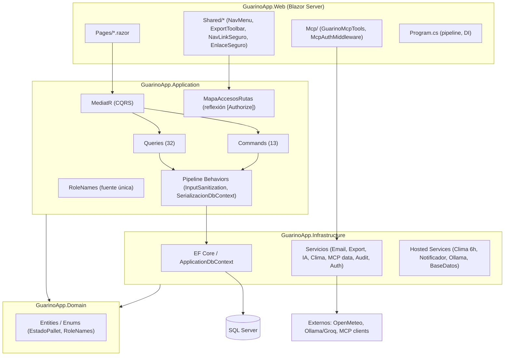

---

## 2. Flujo de autenticación (Local)

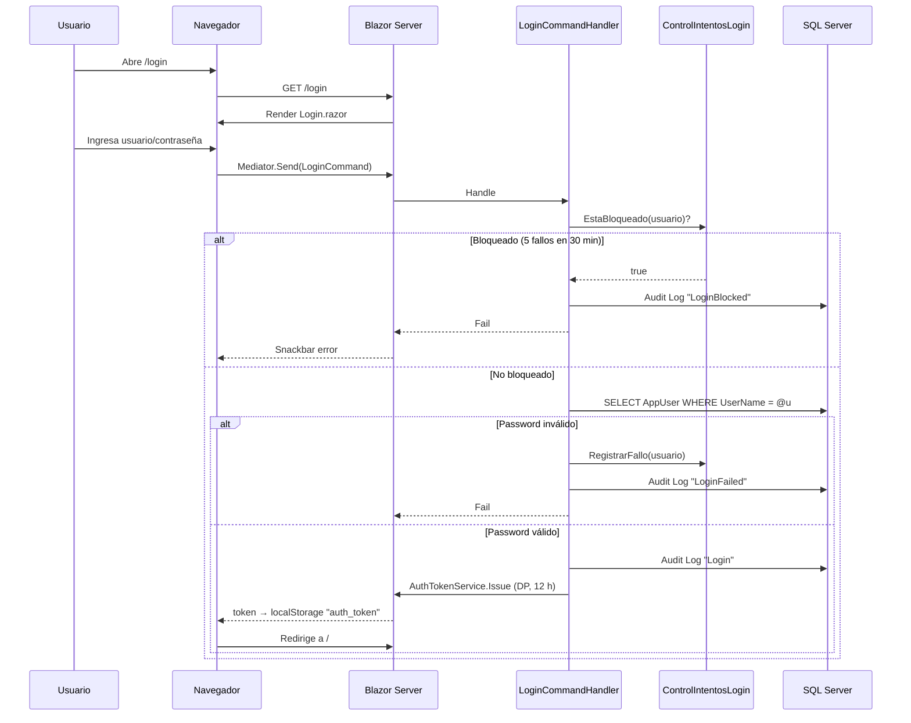

---

## 3. Flujo de consulta de datos (ej. GetPallets / Stock General)

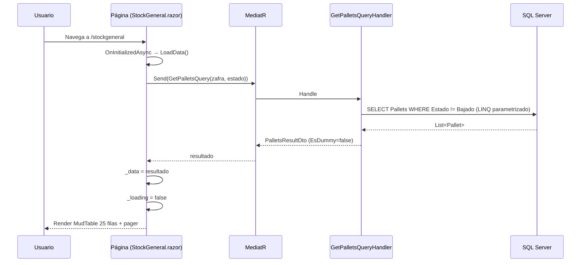

---

## 4. Flujo de creación de usuario (validación + auditoría)

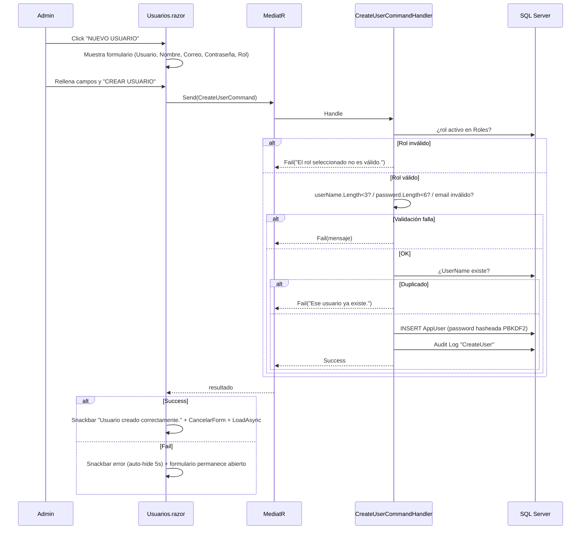

---

## 5. Flujo de paginación (25 filas fijas)

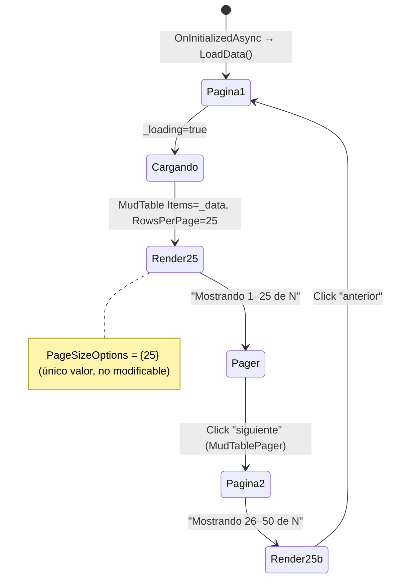

Para Auditoría (server-side): el pager dispara `ServerReload(state)` → handler con `Page=state.Page+1, PageSize=state.PageSize` → SQL `Skip/Take` → devuelve `TotalCount`.

---

## 6. Matriz de acceso por rol (menú e Inicio)

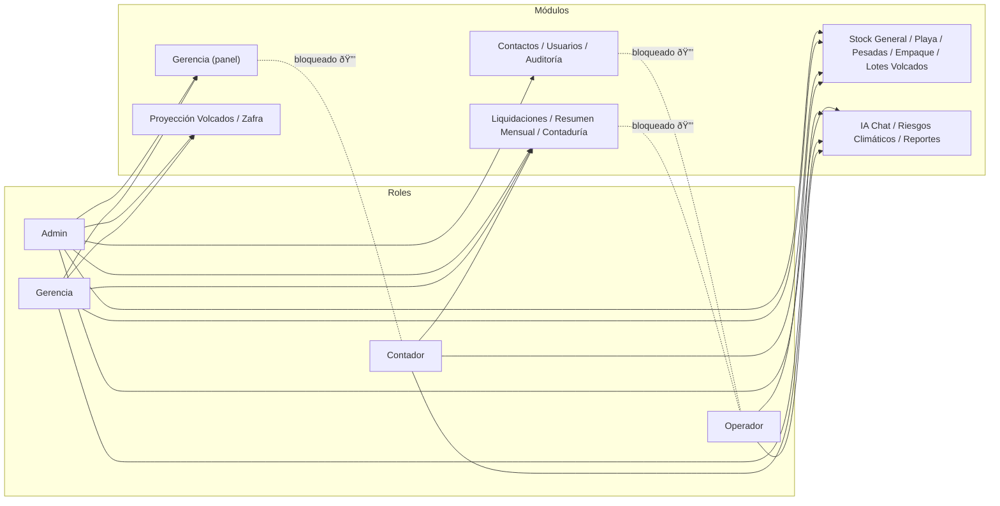

Los módulos bloqueados se **muestran** con 🔒 + tooltip "Requiere: X — tu rol actual: Y" (no se ocultan). La seguridad real la impone cada `[Authorize(Roles=RoleNames.*Autorizacion)]` en la página.

---

## 7. Flujo MCP (Model Context Protocol)

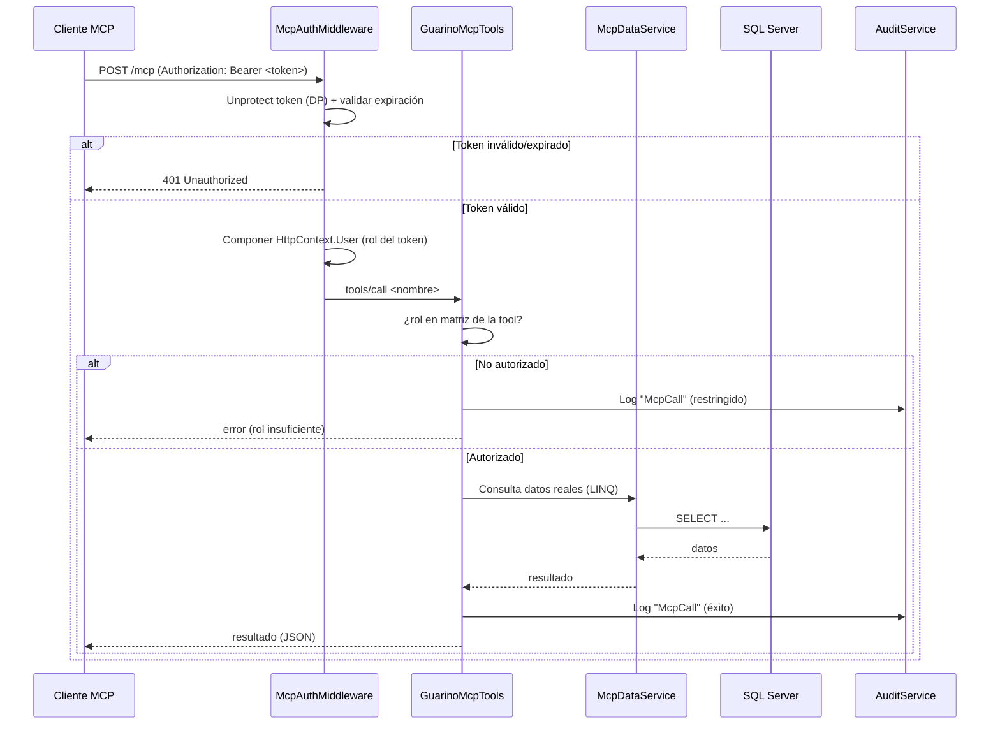

Todas las tools MCP son de **solo lectura** (la importación de contactos queda fuera).

---

## 8. Flujo de filtro IA por rol

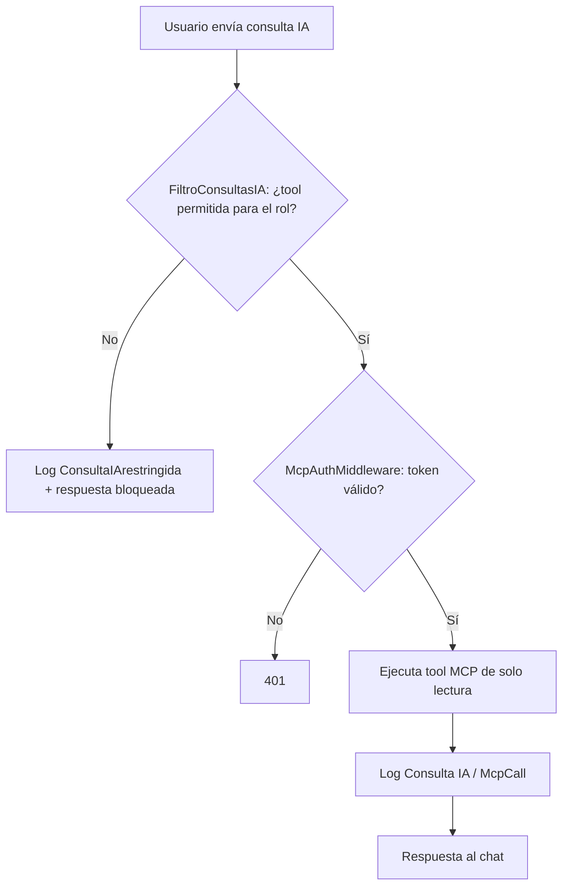

---

## 9. Flujo de auditoría

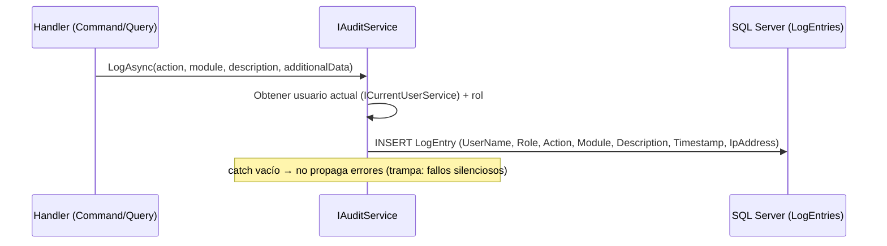

---

## 10. Modelo de datos (entidades clave)

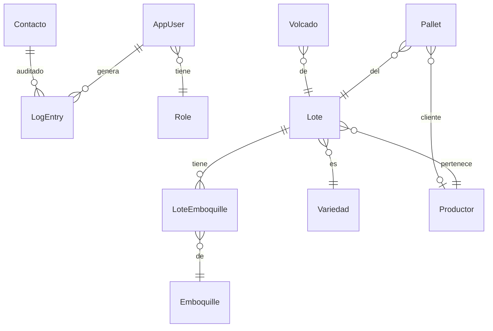

---

## 11. Ciclo de vida de una página Blazor (patrón estándar)

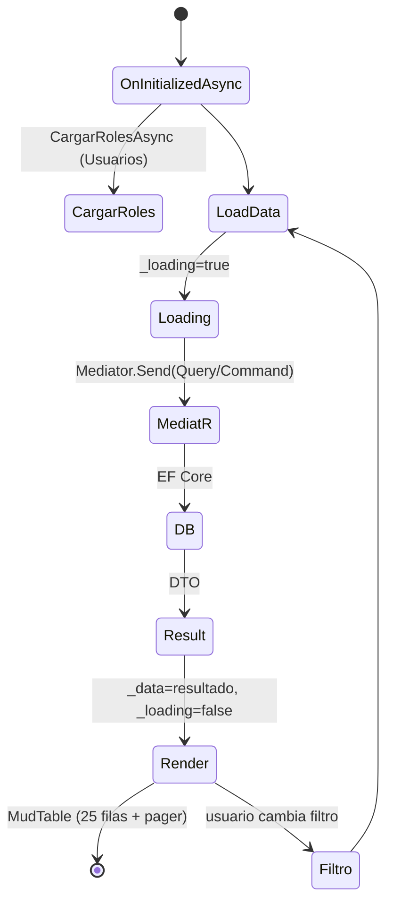

---

*Diagramas generados a partir del código fuente verificado. Formato Mermaid (compatible con GitHub, VS Code, Obsidian).*

---

## Actualizaciones recientes (Oct 2026)

Cambios aplicados al código y reflejados en la documentación:

- **Filtro de módulos por rol (UI)**: `NavMenu.razor` y `Index.razor` muestran los módulos bloqueados con 🔒 + tooltip "Requiere: X — tu rol actual: Y" en lugar de ocultarlos. Componentes nuevos: `Shared/NavLinkSeguro.razor` y `Shared/EnlaceSeguro.razor`. Matriz de acceso por reflexión en `Services/MapaAccesosRutas.cs` (lee `[Authorize]` de las páginas → ruta→roles). Helper `Services/RolUsuario.cs` resuelve el rol actual con `RoleNames`. Registrado como singleton en `Program.cs`.
- **RoleNames como fuente única**: constantes `Admin`/`Gerencia`/`Contador`/`Operador` + grupos `Todos`/`Financieros`/`Administracion` + cadenas `*Autorizacion` para `[Authorize]`. Cero literales de rol en `.razor`.
- **Paginación fija de 25 filas** en las 30 grillas (`RowsPerPage="25"` + `MudTablePager PageSizeOptions="new int[] { 25 }"`). Auditoría usa paginación server-side (`ServerData` + `state.Page/PageSize`).
- **Filtro IA por rol**: `ConsultaIArestringida` (log) + matriz de roles por tool MCP.
- **Servidor MCP** (`/mcp`) con `WithHttpTransport()` + middleware Bearer propio (`McpAuthMiddleware`); tools solo lectura; auditoría `McpCall`.
- **Cero datos inventados**: `GetDummyData`/`GenerarZafrasDummy`/fallbacks eliminados; `EsDummy` siempre `false`; "En nuestro poder" = sin cliente y Estado != Bajado/Despachado.
- **Autenticación**: Negotiate + Data Protection tokens (`GuarinoApp.Auth.v1`, 12 h, localStorage `auth_token`); lockout 5 fallos/15 min.
- **Grillas sin paginador** reemplazado por paginación de 25 (instrucción vigente).
- **Build**: 0 errores / 0 advertencias. UI en español.
