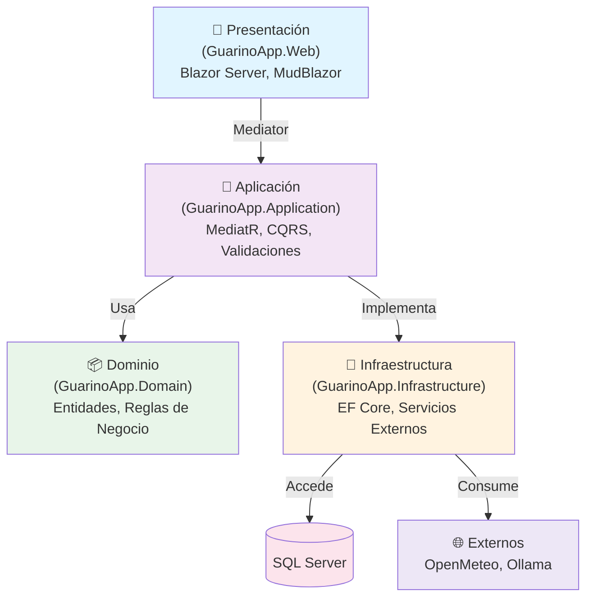
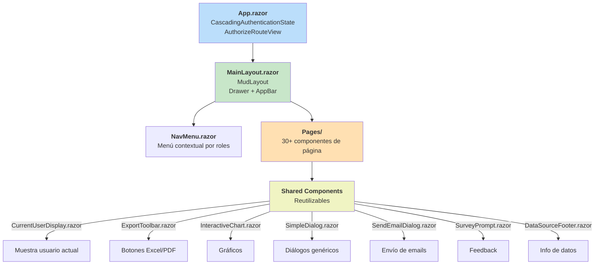
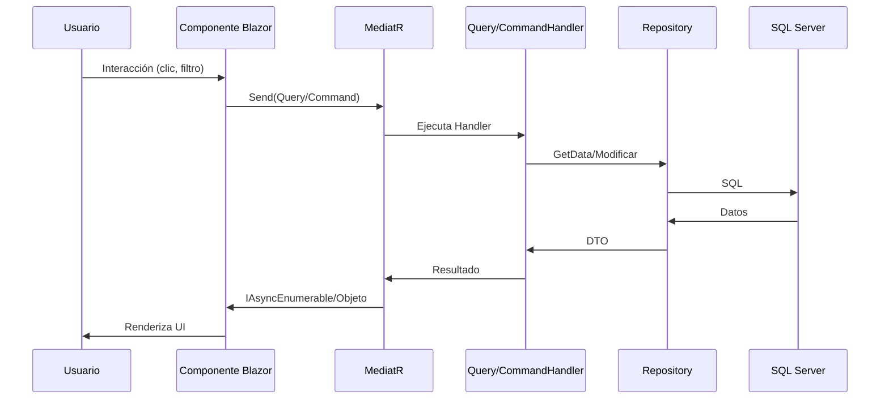
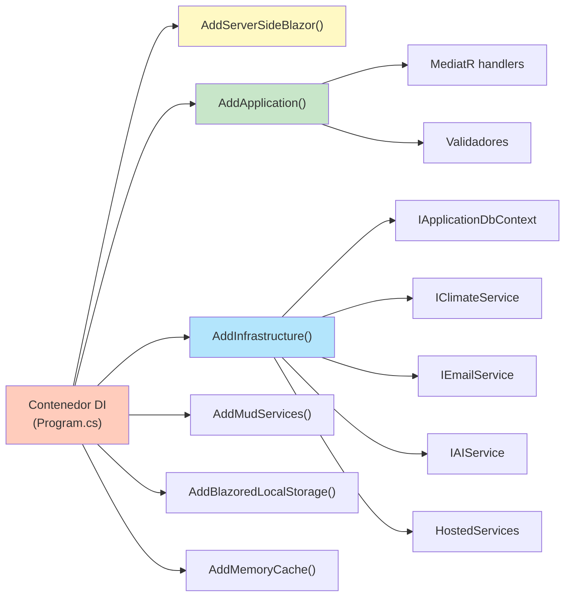
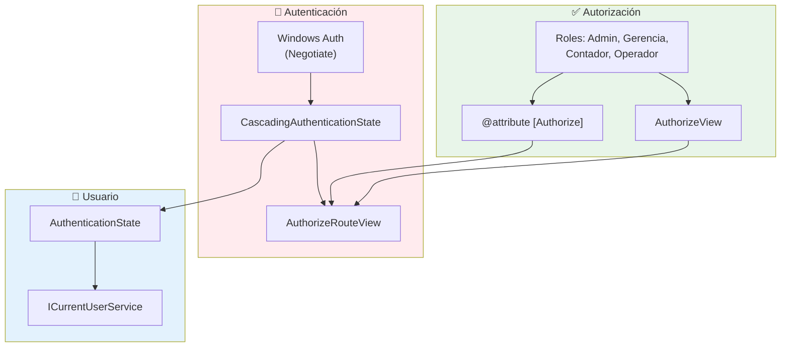
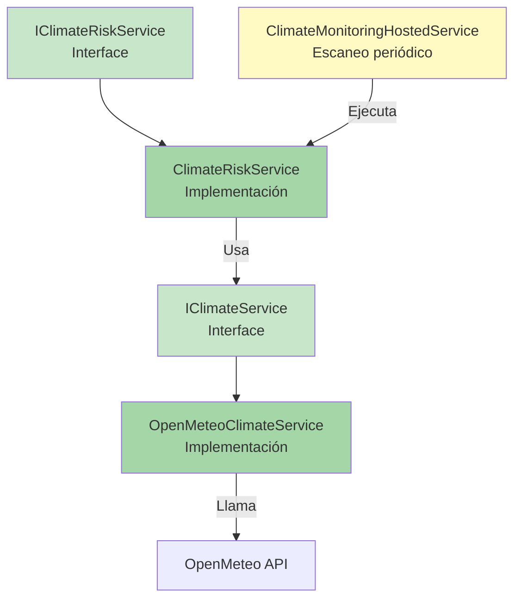
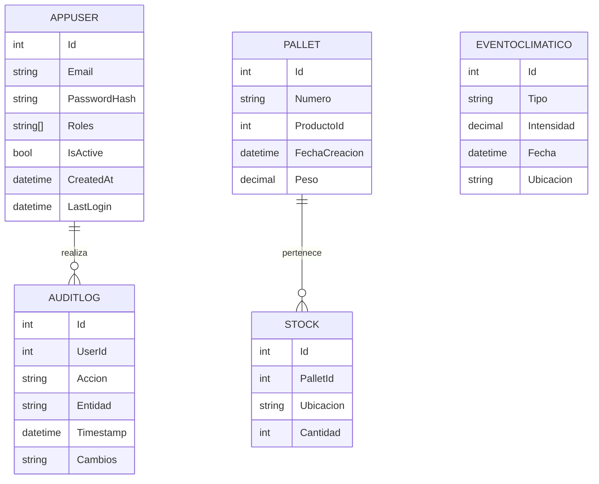
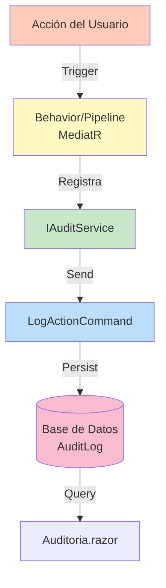
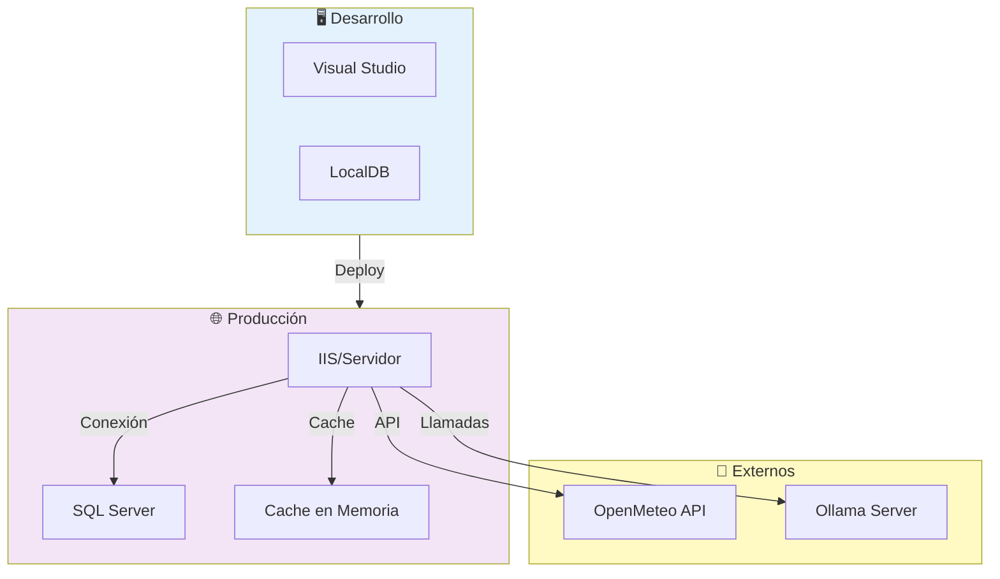

# 📋 Arquitectura GuarinoApp.Web - Wiki Completa

## Índice
1. [Descripción General](#descripción-general)
2. [Arquitectura de Capas](#arquitectura-de-capas)
3. [Componentes Blazor](#componentes-blazor)
4. [Flujo de Datos](#flujo-de-datos)
5. [Seguridad](#seguridad)
6. [Servicios y Utilidades](#servicios-y-utilidades)
7. [Base de Datos](#base-de-datos)
8. [Auditoría](#auditoría)
9. [Despliegue](#despliegue)

---

## Descripción General

**GuarinoApp** es una aplicación web Blazor Server (.NET 8) para gestión de operaciones citríolas. Implementa una arquitectura **Clean Architecture** con separación clara de capas y responsabilidades.

### Stack Tecnológico
- **Framework**: ASP.NET Core 8 + Blazor Server
- **BD**: SQL Server (Entity Framework Core 8)
- **Autenticación**: Windows Authentication (Negotiate)
- **UI**: MudBlazor + Bootstrap
- **Comunicación**: MediatR (CQRS)
- **Servicios Externos**: OpenMeteo (clima), Ollama (IA)

### Características Principales
- 📊 Dashboards ejecutivos con KPIs
- 🤖 Asistente IA integrado (Ollama)
- 🌦️ Monitoreo climático y análisis de riesgos
- 📦 Gestión de stock y pallets
- 💰 Módulo de contaduría y liquidaciones
- 👥 Control de usuarios y auditoría
- 📄 Exportación a Excel y PDF

---

## Arquitectura de Capas



### Descripción de Capas

| Capa | Responsabilidad | Proyecto |
|------|-----------------|----------|
| **Presentación** | Componentes Blazor, UI, enrutamiento | `GuarinoApp.Web` |
| **Aplicación** | Lógica de negocio, CQRS, validaciones | `GuarinoApp.Application` |
| **Dominio** | Entidades, interfaces, reglas core | `GuarinoApp.Domain` |
| **Infraestructura** | BD, servicios externos, implementaciones | `GuarinoApp.Infrastructure` |

---

## Componentes Blazor

### Jerarquía de Componentes



### Páginas Principales por Módulo

#### 🏠 Inicio
- `Index.razor` - Página de bienvenida
- `Dashboard.razor` - Dashboard ejecutivo (KPIs, gráficos)

#### 📦 Operación Diaria (Todos los roles)
- `StockGeneral.razor` - Stock general de producto
- `StockPlaya.razor` - Stock en playa
- `FrutaVolcar.razor` - Fruta pendiente de volcado
- `PalletsSinCliente.razor` - Pallets sin asignación
- `LotesVolcados.razor` - Histórico de lotes
- `RegistroPesadas.razor` - Registro de balanzas
- `Empaque.razor` - Gestión de empaque

#### 🤖 Inteligencia Artificial
- `ProyeccionVolcados.razor` - Proyección de volcados (MLP)
- `ProyeccionZafra.razor` - Análisis estratégico de zafra siguiente
- `IAChat.razor` - Chat con asistente IA (Ollama)

#### 📊 Reportes y Análisis
- `ResumenMensual.razor` - Resumen mensual
- `ResumenLiquidaciones.razor` - Liquidaciones de operarios
- `LiquidacionesQuinta.razor` - Liquidaciones de quinta
- `GraficaProcesos.razor` - Visualización de procesos
- `PalletsContramarca.razor` - Análisis por contramarca
- `PalletsDefinitivos.razor` - Pallets finales (exportación)
- `GestionRiesgosClimaticos.razor` - Riesgos climáticos

#### 🚛 Logística y Recursos
- `Transportistas.razor` - Gestión de transportistas
- `CamionesZorras.razor` - Vehículos
- `Lugares.razor` - Orígenes y destinos
- `Basculas.razor` - Básculas de pesaje

#### 👥 Administración
- `Usuarios.razor` - Gestión de usuarios
- `Auditoria.razor` - Logs de auditoría
- `Contaduria.razor` - Módulo contable

---

## Flujo de Datos

### Ciclo CQRS Principal



### Ejemplo: Obtener Pallets

```csharp
// 1. Componente Blazor dispara
await Mediator.Send(new GetPalletsQuery { 
    Skip = 0, 
    Take = 10 
});

// 2. MediatR enruta a GetPalletsQueryHandler
// 3. Handler consulta IApplicationDbContext
// 4. Repository devuelve IAsyncEnumerable<PalletDto>
// 5. Componente renderiza DataGrid
```

### Inyección de Dependencias



---

## Seguridad

### Modelo de Autenticación



### Jerarquía de Roles

| Rol | Permisos |
|-----|----------|
| **Admin** | Acceso total. Gestión de usuarios, auditoría. |
| **Gerencia** | Dashboard ejecutivo, análisis, reportes, algunos datos administrativos. |
| **Contador** | Contaduría, liquidaciones, proyecciones. |
| **Operador** | Datos operativos diarios, stocks. |

### Protecciones de Seguridad

#### 1. **Control de Acceso por Rol**
```razor
@attribute [Authorize(Roles = "Admin, Gerencia")]
<AuthorizeView Roles="Admin, Gerencia">
    <Authorized>
        <!-- Contenido protegido -->
    </Authorized>
    <NotAuthorized>
        <MudAlert Severity="Severity.Warning">
            No tenés permiso para acceder a esta sección.
        </MudAlert>
    </NotAuthorized>
</AuthorizeView>
```

#### 2. **Sanitización de Entrada**
```csharp
// GuarinoApp.Application/Common/Security/InputSanitizer.cs
public class InputSanitizer
{
    public static string Sanitize(string input)
    {
        // Remove HTML tags, scripts, etc.
    }
}

// Aplicado automáticamente vía InputSanitizationBehavior
```

#### 3. **Rate Limiting**
```csharp
// Program.cs
builder.Services.AddRateLimiter(options =>
{
    options.AddFixedWindowLimiter("fixed", opt =>
    {
        opt.PermitLimit = 100;
        opt.Window = TimeSpan.FromMinutes(1);
    });
});
```

#### 4. **Validación de Datos**
```csharp
// FluentValidation + MediatR behaviors
public class CreateUserCommandValidator : AbstractValidator<CreateUserCommand>
{
    public CreateUserCommandValidator()
    {
        RuleFor(x => x.Email)
            .NotEmpty()
            .EmailAddress()
            .MaximumLength(255);

        RuleFor(x => x.Password)
            .NotEmpty()
            .MinimumLength(8);
    }
}
```

#### 5. **HTTPS Forzado**
```csharp
// Program.cs
app.UseHsts();
app.UseHttpsRedirection();
```

---

## Servicios y Utilidades

### Servicios de Dominio



### Servicios de Aplicación

| Servicio | Responsabilidad |
|----------|-----------------|
| `IExportService` | Exportación a Excel (.xlsx) y PDF |
| `IEmailService` | Envío de correos electrónicos |
| `IAIService` | Integración con Ollama para análisis |
| `IDashboardDataService` | Cálculos y KPIs para dashboards |
| `IAuthorizationService` | Validación de permisos de usuario |
| `ICurrentUserService` | Información del usuario autenticado |
| `IAuditService` | Registro de auditoría |
| `IPdfGenerator` | Generación de reportes PDF |

### Servicios Globales (HostedServices)

```csharp
// Program.cs
builder.Services.AddHostedService<ClimateMonitoringHostedService>();
```

**ClimateMonitoringHostedService**
- Ejecuta periódicamente (ej: cada 1 hora)
- Consulta OpenMeteo para datos climáticos
- Evalúa riesgos climáticos
- Genera alertas si es necesario
- Almacena eventos en BD

---

## Base de Datos

### Contexto de EF Core

```csharp
public class ApplicationDbContext : DbContext, IApplicationDbContext
{
    public DbSet<AppUser> Users { get; set; }
    public DbSet<Pallet> Pallets { get; set; }
    public DbSet<Stock> Stock { get; set; }
    public DbSet<EventoClimaticoDto> EventosClimaticos { get; set; }
    public DbSet<AuditLog> AuditLogs { get; set; }
    // ... más DbSets
}
```

### Tablas Principales



### Configuración de Conexión

```csharp
// Program.cs - Infrastructure/DependencyInjection.cs
var connectionString = configuration.GetConnectionString("DefaultConnection");
services.AddDbContext<ApplicationDbContext>(options =>
    options.UseSqlServer(connectionString)
);
```

---

## Auditoría

### Sistema de Auditoría Integral



### Información Registrada

Cada entrada de auditoría incluye:
- `UserId` - ID del usuario
- `Accion` - Tipo de operación (Create, Update, Delete, Query)
- `Entidad` - Nombre de la entidad afectada
- `Id Entidad` - ID del registro
- `Cambios` - JSON con cambios antes/después
- `Timestamp` - Momento exacto
- `Dirección IP` - Del cliente
- `User Agent` - Navegador/app

### Consulta de Auditoría

```razor
@page "/auditoria"
@attribute [Authorize(Roles = "Admin, Gerencia")]

@* Página que lista todos los cambios del sistema *@
<MudDataGrid Items="logs" Filterable="true" Sortable="true">
    <!-- Mostrar Usuario, Acción, Entidad, Timestamp, Cambios -->
</MudDataGrid>
```

---

## Despliegue

### Diagrama de Despliegue



### Checklist de Despliegue

- [ ] Compilación sin errores (`dotnet build`)
- [ ] Tests unitarios OK (`dotnet test`)
- [ ] Migraciones EF actualizadas (`dotnet ef database update`)
- [ ] Variables de entorno configuradas
  - `ConnectionStrings:DefaultConnection`
  - `ClimateRisk:RegionalContext`
  - `Ollama:Url`
  - `Email:SmtpServer`
  - `IaWeb:ApiKey` (opcional: ruta web gratuita de IA)
  - `Notificaciones:EmailAdmin` (reportes de operación al administrador)
- [ ] HTTPS habilitado
- [ ] Logs centralizados (ej: Application Insights)
- [ ] Backups automáticos de BD
- [ ] Monitoreo activo

### Configuración por Entorno

```json
// appsettings.Development.json
{
  "Logging": {
    "LogLevel": { "Default": "Debug" }
  },
  "ConnectionStrings": {
    "DefaultConnection": "Server=(localdb)..."
  }
}

// appsettings.Production.json
{
  "Logging": {
    "LogLevel": { "Default": "Warning" }
  },
  "ConnectionStrings": {
    "DefaultConnection": "Server=prod-server..."
  }
}
```

---

## Resumen Técnico

| Aspecto | Detalle |
|--------|---------|
| **Lenguaje** | C# 12 |
| **Framework** | ASP.NET Core 8 + Blazor Server |
| **BD** | SQL Server (EF Core 8) |
| **Patrones** | Clean Architecture, CQRS, DI, Repository |
| **Seguridad** | Windows Auth, RBAC, Input Sanitization |
| **Escalabilidad** | Caché en memoria, async/await |
| **Testing** | Unit tests (xUnit/NUnit) |
| **DevOps** | Git, CI/CD ready |

---

**Última actualización**: 2024
**Responsable**: Documentación Técnica
**Versión**: 1.0
