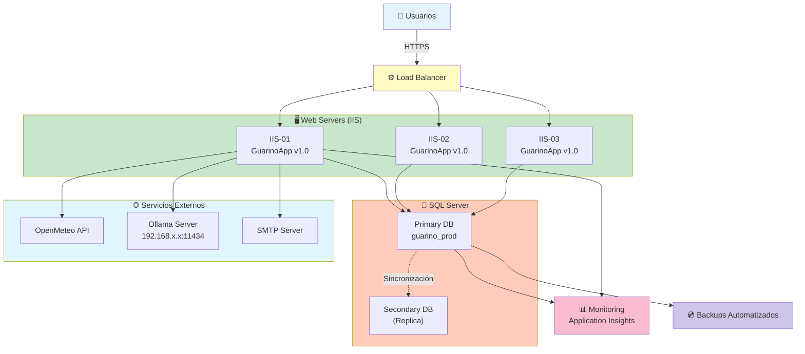

# 🚀 Guía de Despliegue y Mantenimiento - GuarinoApp

## Índice
1. [Requisitos Previos](#requisitos-previos)
2. [Despliegue en Desarrollo](#despliegue-en-desarrollo)
3. [Despliegue en Producción](#despliegue-en-producción)
4. [Configuración por Entorno](#configuración-por-entorno)
5. [Migraciones de BD](#migraciones-de-bd)
6. [Monitoreo y Mantenimiento](#monitoreo-y-mantenimiento)
7. [Troubleshooting](#troubleshooting)
8. [Rollback](#rollback)

---

## Requisitos Previos

### Hardware (Servidor)
- **CPU**: 4+ cores
- **RAM**: 8+ GB
- **Almacenamiento**: 100+ GB (incluir BD)
- **Ancho de banda**: 10+ Mbps

### Software
- **.NET 8 SDK** (desarrollo) / Runtime (producción)
- **SQL Server 2019+** (o SQL Azure)
- **Windows Server 2019+** / IIS 10+
- **Git** (para control de versiones)

### Credenciales Necesarias
- Acceso a repositorio GitHub
- Acceso a SQL Server
- Cuenta de email SMTP (para notificaciones)
- API keys para servicios externos:
  - OpenMeteo (gratis, no requiere key)
  - Ollama (si está hosteado localmente)

---

## Despliegue en Desarrollo

### 1. Clonar Repositorio

```bash
# Clonar proyecto
git clone https://github.com/adrian-silva-uy/guarino.git
cd guarino

# Verificar rama
git status
# En rama: master
```

### 2. Restaurar Dependencias

```bash
# Restaurar NuGet packages
dotnet restore

# Verificar compilación
dotnet build
# Build success ✅
```

### 3. Configurar Base de Datos

```bash
# Navegar a proyecto Infrastructure
cd GuarinoApp.Infrastructure

# Crear/actualizar BD (LocalDB)
dotnet ef database update

# Verificar migraciones
dotnet ef migrations list
# Output: 001_Initial, 002_AddAuditLog, ...
```

### 4. Configurar appsettings.Development.json

```json
{
  "Logging": {
    "LogLevel": {
      "Default": "Information",
      "Microsoft": "Warning"
    }
  },
  "ConnectionStrings": {
    "DefaultConnection": "Server=(localdb)\\mssqllocaldb;Database=GuarinoApp_Dev;Trusted_Connection=true"
  },
  "Ollama": {
    "Enabled": true,
    "Url": "http://localhost:11434",
    "Model": "llama3.2:1b",
    "TimeoutSeconds": 120
  },
  "IaWeb": {
    "Habilitada": true,
    "UrlBase": "https://api.groq.com/openai/v1",
    "Modelo": "openai/gpt-oss-120b",
    "ApiKey": ""
  },
  "Notificaciones": {
    "Habilitadas": true,
    "EmailAdmin": "adriansil@hotmail.com",
    "IntervaloMinutos": 15,
    "Asunto": "Guarino App - logs del día : "
  },
  "Email": {
    "SmtpServer": "smtp.gmail.com",
    "SmtpPort": 587,
    "FromEmail": "test@gmail.com",
    "Password": "app_password_here"
  }
}
```

> Las claves sensibles de desarrollo (`Email:Password`, `IaWeb:ApiKey`) van en
> **user-secrets**, no en el archivo: `dotnet user-secrets set "IaWeb:ApiKey" "gsk_..."`

### 5. Ejecutar Aplicación

```bash
# En directorio raíz
cd GuarinoApp.Web
dotnet run

# Salida esperada:
# info: GuarinoApp.Web.Program[0]
#     GuarinoApp iniciada. Entorno: Development | Ollama: True en http://localhost:11434 | ...
#     IA web en paralelo (plan gratuito): sin clave (solo ruta local) — openai/gpt-oss-120b
# info: GuarinoApp.Web.Program[0]
#     CORS: Development — cualquier origen habilitado.
# info: Microsoft.Hosting.Lifetime[0]
#     Application started. Press Ctrl+C to exit.
```

**Acceder**: http://localhost:5062

---

## Despliegue en Producción

### Arquitectura de Despliegue



### Paso 1: Preparación del Servidor

```bash
# 1. Instalar .NET 8 Runtime
# Descargar desde https://dotnet.microsoft.com/download/dotnet

# 2. Verificar instalación
dotnet --version
# Output: 8.0.x

# 3. Instalar IIS (en Windows Server)
dism /online /enable-feature /featurename:IIS-WebServer /all

# 4. Instalar módulo ASP.NET Core Hosting
# Descargar y ejecutar: dotnet-hosting-8.x.x-win.exe

# 5. Reiniciar servidor
shutdown /r /t 0
```

### Paso 2: Preparar Base de Datos

```bash
# En servidor SQL Server:

# 1. Crear BD
CREATE DATABASE GuarinoApp_Prod;
GO

# 2. Crear usuario de aplicación
CREATE LOGIN GuarinoApp WITH PASSWORD = 'StrongPassword123!';
GO

CREATE USER GuarinoApp FOR LOGIN GuarinoApp;
GO

# 3. Asignar permisos
ALTER ROLE db_owner ADD MEMBER GuarinoApp;
GO

# 4. Habilitar cifrado
ALTER DATABASE GuarinoApp_Prod SET ENCRYPTION ON;
GO

# 5. Configurar backups
-- Backup automático cada día a las 2 AM
BACKUP DATABASE GuarinoApp_Prod 
TO DISK = 'C:\Backups\GuarinoApp_Prod_Daily.bak'
WITH COMPRESSION;
GO
```

### Paso 3: Compilar Release

```bash
# En máquina de desarrollo

# Limpiar y compilar
dotnet clean
dotnet publish -c Release -o ./publish

# Salida:
# C:\...\publish\
# ├── GuarinoApp.Web.exe
# ├── appsettings.json
# ├── web.config
# └── (más archivos)
```

### Paso 4: Desplegar en IIS

```bash
# 1. Crear sitio en IIS Manager

# PowerShell (como Admin):
New-IISSite -Name "GuarinoApp" `
    -BindingInformation "*:443:guarino.company.com:https" `
    -PhysicalPath "C:\inetpub\guarino" `
    -ApplicationPool ".NET AppPool v4.0"

# 2. Copiar archivos publicados
Copy-Item -Path ".\publish\*" -Destination "C:\inetpub\guarino" -Recurse

# 3. Configurar permisos
icacls "C:\inetpub\guarino" /grant:r "IIS AppPool\GuarinoApp:(OI)(CI)F"

# 4. Instalar certificado SSL
# (Usar Let's Encrypt o certificado interno)
```

### Paso 5: Configurar appsettings.Production.json

El archivo real desplegado es `GuarinoApp.Web/appsettings.Production.json` (este
repo). Sus claves deben coincidir con las secciones que la app realmente lee —
`Ollama`, `Email`, `ClimateRisk`, `IaWeb`, `Cors`:

```json
{
  "ConnectionStrings": {
    "DefaultConnection": "Server=sqlserver.internal;Database=GuarinoApp_Prod;User=GuarinoApp;Password=StrongPassword123!;TrustServerCertificate=True"
  },
  "Ollama": {
    "Url": "http://192.168.1.100:11434",
    "Model": "phi3:3.8b",
    "TimeoutSeconds": 300
  },
  "IaWeb": {
    "Habilitada": true,
    "UrlBase": "https://api.groq.com/openai/v1",
    "Modelo": "openai/gpt-oss-120b",
    "ApiKey": "",
    "TimeoutSegundos": 45,
    "ConsultasWebSimultaneas": 4,
    "EsperaLocalSegundos": 12
  },
  "Cors": {
    "AllowedOrigins": [ "https://guarino.company.com" ]
  },
  "Notificaciones": {
    "Habilitadas": true,
    "EmailAdmin": "adriansil@hotmail.com",
    "IntervaloMinutos": 15,
    "Asunto": "Guarino App - logs del día : "
  },
  "Email": {
    "SmtpServer": "smtp.office365.com",
    "SmtpPort": 587,
    "FromEmail": "noreply@guarino.com.uy",
    "Password": "app_password"
  },
  "Logging": {
    "LogLevel": {
      "Default": "Information",
      "Microsoft.AspNetCore": "Warning"
    }
  },
  "AllowedHosts": "*"
}
```

Notas de producción:

- **`IaWeb:ApiKey` NUNCA va en el archivo**: se inyecta con la variable de
  entorno `IaWeb__ApiKey` (ver «Variables de Entorno» más abajo). Sin clave, la
  ruta web queda apagada y la app sigue 100% por la ruta local + plan
  determinista — sin errores.
- **`Cors:AllowedOrigins`** gobierna solo peticiones cross-origin; con la lista
  vacía la app responde exclusivamente en mismo origen (estado seguro por
  defecto). Reemplazá `guarino.company.com` por el dominio real del binding IIS.

### Paso 6: Migraciones de BD

```bash
# En servidor de BD:

# Opción A: Usar dotnet ef (si .NET 8 instalado)
dotnet ef database update --configuration Release

# Opción B: Generar script SQL (Recomendado)
dotnet ef migrations script -o migrate_prod.sql

# Luego ejecutar SQL script en SQL Management Studio
```

### Paso 7: Verificar Despliegue

```bash
# 1. Acceder a aplicación
# https://guarino.company.com

# 2. Verificar logs de IIS
Get-Content "C:\inetpub\logs\LogFiles\W3SVC1\*.log" -Tail 20

# 3. Verificar conectividad BD
# En IIS Manager > Aplicación > Advanced Settings > Test Connection

# 4. Probar servicios externos
# Abrir navegador > Consola de desarrollador > Network
# Verificar que OpenMeteo responde

# 5. Verificar el arranque de IA, CORS y reportes en los logs de la app:
#    "GuarinoApp iniciada ... | IA web en paralelo (plan gratuito): habilitada"
#    "CORS: Production — solo orígenes permitidos: https://guarino.company.com"
#    "Reportes de operación: SOLO a adriansil@hotmail.com cada 15 min ..."
#    (si la línea de IA dice "sin clave (solo ruta local)", falta la variable
#     IaWeb__ApiKey — la app funciona igual por la ruta local)
#    A los ~40 s del arranque debe verse: "Reporte de operación enviado a ..."
#    (ese primer correo confirma que el SMTP y el destinatario funcionan)
```

---

## Configuración por Entorno

### Archivo appsettings.json Base

```json
{
  "Logging": {
    "LogLevel": {
      "Default": "Information"
    }
  },
  "AllowedHosts": "*",
  "ConnectionStrings": {
    "DefaultConnection": ""
  }
}
```

### Variables de Entorno (Recomendado)

```bash
# En servidor (Windows CMD):
setx ASPNETCORE_ENVIRONMENT Production
setx ConnectionStrings__DefaultConnection "Server=...;Password=..."
setx Ollama__Url "http://localhost:11434"
setx Email__Password "app_password"
setx IaWeb__ApiKey "gsk_..."     # clave gratuita de console.groq.com (NUNCA en el repo)
setx Cors__AllowedOrigins__0 "https://guarino.company.com"
setx Notificaciones__EmailAdmin "adriansil@hotmail.com"   # único destinatario de reportes

# En servidor (PowerShell):
[Environment]::SetEnvironmentVariable(
    "ASPNETCORE_ENVIRONMENT", 
    "Production", 
    "Machine"
)
```

> Los nombres usan `__` como separador de niveles (`Sección:Clave` →
> `Seccion__Clave`). `setx` solo afecta a procesos iniciados **después** del
> `setx`: reiniciá el app pool de IIS o el servidor.

### Secret Manager (Desarrollo)

```bash
# Inicializar secrets
dotnet user-secrets init

# Establecer secrets
dotnet user-secrets set "ConnectionStrings:DefaultConnection" "Server=...;Password=..."
dotnet user-secrets set "Email:Password" "app_password"
dotnet user-secrets set "IaWeb:ApiKey" "gsk_..."   # IA web gratuita (opcional)

# Verificar
dotnet user-secrets list
```

### Azure Key Vault (Recomendado para Producción)

```csharp
// Program.cs
var keyVaultUrl = new Uri(builder.Configuration["KeyVault:Url"]);
var credential = new DefaultAzureCredential();
builder.Configuration.AddAzureKeyVault(keyVaultUrl, credential);
```

---

## Migraciones de BD

### Crear Nueva Migración

```bash
# 1. Realizar cambios en entidades (Domain)
// Ejemplo: Agregar propiedad a AppUser
public class AppUser
{
    // ...
    public DateTime? LastPasswordChange { get; set; }  // NUEVA
}

# 2. Crear migración
dotnet ef migrations add AddLastPasswordChangeToAppUser

# 3. Revisar archivo generado
# GuarinoApp.Infrastructure/Migrations/xxx_AddLastPasswordChangeToAppUser.cs

# 4. Aplicar localmente
dotnet ef database update

# 5. Generar script SQL
dotnet ef migrations script -o add_password_change.sql

# 6. En producción: Ejecutar script en SQL Management Studio
```

### Migración Segura en Producción

```sql
-- 1. BACKUP PREVIO
BACKUP DATABASE GuarinoApp_Prod 
TO DISK = 'C:\Backups\GuarinoApp_Prod_BeforeMigration.bak';
GO

-- 2. Ejecutar migración dentro de transacción
BEGIN TRANSACTION;

-- Comando de migración EF o SQL directo
ALTER TABLE AppUsers
ADD LastPasswordChange DATETIME NULL;

COMMIT TRANSACTION;
-- Si hay error: ROLLBACK TRANSACTION;

-- 3. Verificar
SELECT TOP 1 * FROM AppUsers;
```

### Rollback de Migración

```bash
# Local: Revertir última migración
dotnet ef migrations remove

# Producción: Restaurar BD desde backup
# En SQL Management Studio:
# Restore Database > Select Backup > Proceed
```

---

## Monitoreo y Mantenimiento

### Monitoreo de Rendimiento

```csharp
// Program.cs - Agregar Application Insights
builder.Services.AddApplicationInsightsTelemetry();
```

**Métricas a Monitorear**:
- 📊 Tiempo de respuesta promedio
- 🔴 Tasa de errores (> 1%)
- 💾 Uso de memoria (> 80%)
- 🌐 Conexiones activas a BD
- 📈 Solicitudes por segundo

### Health Checks

```csharp
// Program.cs
builder.Services.AddHealthChecks()
    .AddDbContextCheck<ApplicationDbContext>()
    .AddUrlGroup(new Uri("https://api.open-meteo.com/v1/forecast"))
    .AddCheck("Ollama", 
        async () => 
        {
            var response = await httpClient.GetAsync("http://localhost:11434/api/tags");
            return response.IsSuccessStatusCode 
                ? HealthCheckResult.Healthy() 
                : HealthCheckResult.Unhealthy();
        });

app.MapHealthChecks("/health");
```

**Acceder**: https://guarino.company.com/health

### Logs Centralizados

```csharp
// Configurar Serilog (recomendado)
builder.Host.UseSerilog((context, config) =>
{
    config
        .MinimumLevel.Override("Microsoft", LogEventLevel.Warning)
        .WriteTo.Console()
        .WriteTo.File("logs/guarino-.txt", 
            rollingInterval: RollingInterval.Day)
        .WriteTo.ApplicationInsights(new TelemetryConverter());
});
```

### Mantenimiento Preventivo

| Tarea | Frecuencia | Responsable |
|-------|-----------|-------------|
| Backup BD | Diario | DevOps |
| Logs limpieza | Semanal | DevOps |
| Parches OS | Mensual | IT |
| Renovación certificados | Anual | IT |
| Auditoría de seguridad | Trimestral | Security |
| Load testing | Semestral | QA |

---

## Troubleshooting

### Problema: BD no accesible

```
Error: A network-related or instance-specific error 
occurred while establishing a connection to SQL Server.
```

**Diagnóstico**:
```powershell
# Verificar conectividad
Test-NetConnection -ComputerName sqlserver.internal -Port 1433

# Verificar connection string
$connStr = "Server=sqlserver.internal;Database=GuarinoApp_Prod;"
sqlcmd -S sqlserver.internal -U GuarinoApp

# Verificar permisos
SELECT * FROM fn_my_permissions (NULL, 'DATABASE');
```

**Solución**:
1. Verificar SQL Server está online
2. Verificar credenciales en appsettings
3. Verificar firewall permite puerto 1433
4. Verificar usuario tiene permisos

---

### Problema: Aplicación lenta

```
Tiempo de respuesta > 3 segundos
```

**Diagnóstico**:
```csharp
// Habilitar logging detallado
builder.Services.AddLogging(config =>
{
    config.AddConsole();
    config.SetMinimumLevel(LogLevel.Debug);
});

// Revisar logs para queries lentas
// Buscar: "Executing DbCommand with timeout"
```

**Soluciones**:
1. Optimizar queries (índices, proyecciones)
2. Habilitar caching
3. Aumentar connection pool
4. Revisar recursos del servidor

---

### Problema: Alto uso de memoria

```
Memory > 80% de límite
```

**Diagnóstico**:
```powershell
# Ver procesos
Get-Process | Sort-Object WorkingSet -Descending | Select-Object -First 5

# Ver memoria por IIS app pool
Get-IISAppPool | Select-Object -Property Name, Recycling

# Memory dump
$proc = Get-Process "w3wp"
# Crear dump con Windows Task Manager o WinDbg
```

**Soluciones**:
1. Reducir cache size
2. Configurar AppPool recycling
3. Revisar memory leaks en código
4. Aumentar RAM del servidor

---

### Problema: Error de autenticación

```
401 Unauthorized - Windows Auth falla
```

**Diagnóstico**:
```powershell
# Verificar Kerberos
setspn -L DOMAIN\usuario

# Verificar IIS
Test-IISAppPoolIdentity -AppPoolName "GuarinoApp"

# Verificar credential
whoami /priv
```

**Soluciones**:
1. Configurar SPN (Service Principal Name)
2. Reiniciar app pool
3. Verificar usuario está en grupo AD

---

## Rollback

### Rollback de Aplicación

```bash
# 1. Mantener versión anterior en C:\inetpub\guarino_backup\

# 2. Si deployment falla, copiar versión anterior
Copy-Item -Path "C:\inetpub\guarino_backup\*" `
    -Destination "C:\inetpub\guarino" -Recurse -Force

# 3. Reiniciar IIS
Restart-WebAppPool -Name "GuarinoApp"

# 4. Verificar aplicación
# Acceder a https://guarino.company.com
```

### Rollback de BD

```sql
-- Restaurar desde backup
RESTORE DATABASE GuarinoApp_Prod
FROM DISK = 'C:\Backups\GuarinoApp_Prod_Daily.bak'
WITH REPLACE;
GO

-- Verificar integridad
DBCC CHECKDB (GuarinoApp_Prod);
GO
```

### Procedimiento de Rollback Completo

```bash
#!/bin/bash
# Script: rollback.sh

set -e

echo "🔄 Iniciando rollback..."

# 1. Parar aplicación
iisreset /stop

# 2. Restaurar código
cp -r /backup/guarino_v1.0/* /inetpub/guarino/

# 3. Restaurar BD
sqlcmd -S sqlserver -U GuarinoApp <<EOF
  RESTORE DATABASE GuarinoApp_Prod
  FROM DISK = '/backup/GuarinoApp_Prod.bak'
  WITH REPLACE
EOF

# 4. Iniciar aplicación
iisreset /start

echo "✅ Rollback completado"
echo "📧 Notificando al equipo..."
```

---

## Checklist de Despliegue

### Pre-Despliegue
- [ ] Código revisado y aprobado (PR)
- [ ] Tests unitarios pasados
- [ ] Build en Release mode exitoso
- [ ] Migraciones de BD revisadas
- [ ] Secrets configurados en servidor (`IaWeb__ApiKey`, `Email__Password`, conexión BD)
- [ ] Backup de BD creado
- [ ] Plan de rollback documentado

### Despliegue
- [ ] Aplicación copiada a servidor
- [ ] Permisos de carpeta configurados
- [ ] Migraciones de BD ejecutadas
- [ ] Sitio IIS iniciado
- [ ] Verificación de health checks
- [ ] Acceso a aplicación confirmado

### Post-Despliegue
- [ ] Monitoreo de logs activo
- [ ] Tests de humo en producción
- [ ] Notificación a usuarios
- [ ] Documentación actualizada
- [ ] Métricas de rendimiento revisadas
- [ ] Ambiente preparado para próximo despliegue

---

**Última actualización**: 2024-01-XX  
**Responsable**: DevOps Team  
**Versión**: 1.0
---

## Actualizaciones recientes (Oct 2026)

Cambios aplicados al código y reflejados en la documentación:

- **Filtro de módulos por rol (UI)**: `NavMenu.razor` y `Index.razor` muestran los módulos bloqueados con candado y tooltip "Requiere: X — tu rol actual: Y" en lugar de ocultarlos. Componentes nuevos: `Shared/NavLinkSeguro.razor` y `Shared/EnlaceSeguro.razor`. Matriz de acceso por reflexión en `Services/MapaAccesosRutas.cs` (lee `[Authorize]` de las páginas → ruta→ roles). Helper `Services/RolUsuario.cs` resuelve el rol actual con `RoleNames`. Registrado como singleton en `Program.cs`.
- **RoleNames como fuente única**: constantes `Admin`/`Gerencia`/`Contador`/`Operador` + grupos `Todos`/`Financieros`/`Administracion` + cadenas `*Autorizacion` para `[Authorize]`. Cero literales de rol en `.razor`.
- **Paginación fija de 25 filas** en las 30 grillas (`RowsPerPage="25"` + `MudTablePager PageSizeOptions="new int[] { 25 }"`). Auditoría usa paginación server-side (`ServerData` + `state.Page/PageSize`).
- **Filtro IA por rol**: `ConsultaIArestringida` (log) + matriz de roles por tool MCP.
- **Servidor MCP** (`/mcp`) con `WithHttpTransport()` + middleware Bearer propio (`McpAuthMiddleware`); tools solo lectura; auditoría `McpCall`.
- **Cero datos inventados**: `GetDummyData`/`GenerarZafrasDummy`/fallbacks eliminados; `EsDummy` siempre `false`; "En nuestro poder" = sin cliente y Estado != Bajado/Despachado.
- **Autenticación**: Negotiate + Data Protection tokens (`GuarinoApp.Auth.v1`, 12 h, localStorage `auth_token`); lockout 5 fallos/15 min.
- **Grillas sin paginador** reemplazado por paginación de 25 (instrucción vigente).
- **Build**: 0 errores / 0 advertencias. UI en español.
- **Diagramas Mermaid**: 40 bloques en `docs/diagramas.md` y otros archivos (arquitectura, flujos, seguridad, servicios). Renderizan en GitHub, VS Code (con extensión), Obsidian.
- **Wiki de usuario**: `docs/WIKI_USUARIO.md` con manual funcional por módulo y rol.
- **Auditoría exhaustiva**: `docs/auditoria-exhaustiva.md` (OWASP + UX + deuda técnica).
- **Documentación inversa**: `docs/documentacion-inversa.md` (arquitectura, módulos, decisiones, trampas).