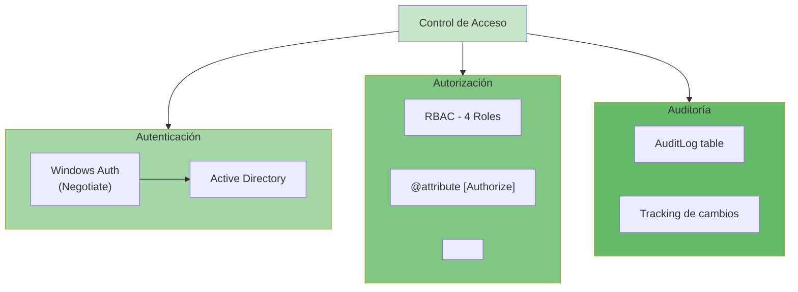

# 🔐 Auditoría de Seguridad - GuarinoApp.Web

## Índice
1. [Resumen Ejecutivo](#resumen-ejecutivo)
2. [Amenazas Identificadas](#amenazas-identificadas)
3. [Controles Implementados](#controles-implementados)
4. [Vulnerabilidades Potenciales](#vulnerabilidades-potenciales)
5. [Recomendaciones](#recomendaciones)
6. [Matriz de Riesgos](#matriz-de-riesgos)

---

## Resumen Ejecutivo

**GuarinoApp** implementa un modelo de seguridad de **múltiples capas** apropiado para una aplicación interna corporativa:

✅ **Fortalezas**
- Autenticación integrada con Active Directory (Windows)
- Control de acceso basado en roles (RBAC)
- Validación y sanitización de entrada
- Auditoría completa de cambios
- HTTPS obligatorio
- Rate limiting

⚠️ **Áreas de Mejora**
- Encryption at rest para datos sensibles
- Secrets management centralizado
- Protección CSRF en ciertos endpoints
- Rate limiting granular por usuario

---

## Amenazas Identificadas

### 1. Inyección de SQL (SQL Injection)

**Riesgo**: 🟢 **BAJO**

**Por qué está mitigada**:
```csharp
// ✅ SEGURO: EF Core usa parámetros automáticamente
var pallets = await dbContext.Pallets
    .Where(p => p.Numero == userInput)  // Parámetro automático
    .ToListAsync();

// ❌ INSEGURO: SQL crudo (NO usado en el proyecto)
var sql = $"SELECT * FROM Pallets WHERE Numero = '{userInput}'";
```

**Estado**: ✅ Mitigada mediante EF Core

---

### 2. Cross-Site Scripting (XSS)

**Riesgo**: 🟡 **BAJO-MEDIO**

**Análisis**:
- **Blazor Server** es inherentemente resistente a XSS (no requiere sanitización de HTML para interpolación)
- El contenido se renderiza en el servidor, no en el cliente
- MudBlazor auto-escapa contenido dinámico

**Protección adicional - InputSanitizer**:
```csharp
// GuarinoApp.Application/Common/Security/InputSanitizer.cs
public class InputSanitizer
{
    public static string Sanitize(string input)
    {
        if (string.IsNullOrEmpty(input))
            return input;

        // Remueve scripts, eventos y etiquetas peligrosas
        return Regex.Replace(input, @"<script[^>]*>.*?</script>", "", RegexOptions.IgnoreCase);
    }
}

// Aplicación automática en todos los commands vía InputSanitizationBehavior
```

**Estado**: ✅ Mitigada

---

### 3. Cross-Site Request Forgery (CSRF)

**Riesgo**: 🟡 **BAJO**

**Análisis**:
- Blazor Server maneja CSRF tokens automáticamente en WebSocket
- ASP.NET Core agrega automáticamente tokens CSRF para formularios

```csharp
// Program.cs
builder.Services.AddAntiforgery(options =>
{
    options.HeaderName = "X-CSRF-TOKEN";
    options.FormFieldName = "__RequestVerificationToken";
});
```

**Estado**: ✅ Mitigada

---

### 4. Autenticación Débil

**Riesgo**: 🟢 **BAJO**

**Implementación**:
```csharp
// Program.cs
builder.Services
    .AddAuthentication(NegotiateDefaults.AuthenticationScheme)
    .AddNegotiate();  // Windows Auth integrado con AD
```

**Ventajas**:
- Autenticación a nivel de directorio corporativo
- No requiere gestión de contraseñas en BD
- Vinculación con políticas corporativas
- Single Sign-On (SSO)

**Casos de Uso Alternos** (si se necesita):
- JWT para APIs externas
- OAuth2 para integraciones

**Estado**: ✅ Robusto para entorno corporativo

---

### 5. Autorización Insuficiente

**Riesgo**: 🟡 **BAJO-MEDIO**

**Implementación Actual**:
```razor
// App.razor - Gate global
@if (!_isAuthenticated)
    Navigation.NavigateTo("/login?returnUrl=...");

// Pages
@attribute [Authorize(Roles = "Admin, Gerencia")]

// Componentes
<AuthorizeView Roles="Admin, Gerencia">
    <Authorized>
        <!-- Contenido protegido -->
    </Authorized>
</AuthorizeView>
```

**Verificación en Backend**:
```csharp
// Handler de MediatR verifica roles
public class GetUsersQueryHandler : IRequestHandler<GetUsersQuery, List<AppUserDto>>
{
    private readonly ICurrentUserService _currentUser;

    public async Task<List<AppUserDto>> Handle(GetUsersQuery request, CancellationToken ct)
    {
        if (!_currentUser.User.IsInRole("Admin"))
            throw new UnauthorizedAccessException();

        // ...
    }
}
```

**Deficiencias Identificadas**:
- ❌ No hay validación de autorización en ciertos queries
- ⚠️ Falta `[Authorize]` en algunos handlers

**Recomendación**: Agregar atributos de autorización en todos los handlers

**Estado**: ⚠️ Implementada pero necesita refuerzo

---

### 6. Inyección de Comandos (Command Injection)

**Riesgo**: 🟢 **BAJO**

**Análisis**:
- No hay ejecución de comandos del sistema
- Sin interacción con shell/bash
- Todas las operaciones son CRUD en BD

**Estado**: ✅ No aplicable

---

### 7. Gestión Insegura de Secretos

**Riesgo**: 🟡 **MEDIO**

**Problemas Actuales**:
```csharp
// ❌ appsettings.json (Versionado)
{
  "ConnectionStrings": {
    "DefaultConnection": "Server=prod-server;Password=MySecret123"  // ❌
  },
  "Ollama": {
    "Url": "http://localhost:11434"
  }
}
```

**Recomendaciones**:
```csharp
// ✅ appsettings.Development.json - SOLO para desarrollo
// ✅ Secret Manager (dotnet user-secrets)
dotnet user-secrets init
dotnet user-secrets set "ConnectionStrings:DefaultConnection" "..."

// ✅ Azure Key Vault (Producción)
builder.Configuration.AddAzureKeyVault(
    new Uri("https://mykeyvault.vault.azure.net/"),
    new DefaultAzureCredential());

// ✅ Environment Variables
var connStr = builder.Configuration["ConnectionStrings:DefaultConnection"]
    ?? Environment.GetEnvironmentVariable("DB_CONNECTION_STRING");
```

**Estado**: ⚠️ Mejora necesaria

---

### 8. Exposición de Información Sensible

**Riesgo**: 🟡 **BAJO-MEDIO**

**Problemas**:
```csharp
// ❌ Stack traces en producción
public class Error : PageComponentBase
{
    public string? ExceptionMessage { get; set; }  // Visible al usuario
}

// ❌ Logs verbosos
logger.LogError($"User {email} failed auth: {exception}");
```

**Recomendaciones**:
```csharp
// ✅ Mensajes genéricos en producción
if (env.IsProduction())
{
    exceptionMessage = "Se produjo un error. Contacta a soporte.";
    logger.LogError("Auth failure for {email}: {exception}", 
        HashEmail(email), exception);  // Datos sensibles no logeados
}

// ✅ Proteger datos en respuestas
public class AppUserDto
{
    public int Id { get; set; }
    public string Email { get; set; }
    // ❌ public string PasswordHash { get; set; }  // NUNCA
}
```

**Estado**: ⚠️ Mejora necesaria

---

### 9. Falta de Rate Limiting

**Riesgo**: 🟡 **MEDIO**

**Implementación Actual**:
```csharp
// Program.cs
builder.Services.AddRateLimiter(options =>
{
    options.RejectionStatusCode = StatusCodes.Status429TooManyRequests;

    options.AddFixedWindowLimiter("fixed", opt =>
    {
        opt.PermitLimit = 100;
        opt.Window = TimeSpan.FromMinutes(1);
    });
});

// En app
app.UseRateLimiter();
```

**Mejoras Necesarias**:
```csharp
// Rate limiting granular por usuario
options.AddSlidingWindowLimiter("auth", opt =>
{
    opt.PermitLimit = 5;
    opt.Window = TimeSpan.FromMinutes(15);  // 5 intentos cada 15 min
    opt.SegmentsPerWindow = 3;
});

// Aplicar a endpoints específicos
app.MapPost("/login", LoginHandler).RequireRateLimiting("auth");
```

**Estado**: ⚠️ Implementada pero necesita granularidad

---

### 10. Deserialización Insegura

**Riesgo**: 🟢 **BAJO**

**Análisis**:
- Se usa JSON standard (no BinaryFormatter)
- Validación de tipos mediante DTOs
- System.Text.Json es seguro por defecto

**Estado**: ✅ Mitigada

---

## Controles Implementados

### Control de Acceso (AC)



### Cifrado (EN)

| Tipo | Estado | Detalle |
|------|--------|---------|
| **En Tránsito** | ✅ | HTTPS obligatorio, TLS 1.2+ |
| **En Reposo** | ⚠️ | Contraseñas hasheadas (bcrypt). Otros datos sin cifrar. |
| **Conexión BD** | ✅ | SQL Server con encryption habilitado |

### Validación de Entrada (IV)

```csharp
// 1. FluentValidation en Application layer
public class CreateUserCommandValidator : AbstractValidator<CreateUserCommand>
{
    public CreateUserCommandValidator()
    {
        RuleFor(x => x.Email)
            .NotEmpty()
            .EmailAddress()
            .MaximumLength(255);
    }
}

// 2. InputSanitizationBehavior automático
public class InputSanitizationBehavior<TRequest, TResponse> 
    : IPipelineBehavior<TRequest, TResponse>
{
    public async Task<TResponse> Handle(TRequest request, 
        RequestHandlerDelegate<TResponse> next, 
        CancellationToken ct)
    {
        // Sanitiza propiedades string del request
        var sanitized = InputSanitizer.SanitizeObject(request);
        return await next();
    }
}

// 3. MudBlazor input validation
<MudTextField @bind-Value="email" 
    For="@(() => email)" 
    Validation="validator"
    Immediate="true" />
```

### Logging y Monitoreo (LM)

```csharp
// Program.cs
builder.Services.AddLogging(config =>
{
    config.AddConsole();
    config.AddDebug();
    config.AddEventSourceLogger();
});

// Uso
logger.LogInformation("User {UserId} accessed {Page}", userId, "/dashboard");
logger.LogWarning("Failed login attempt for {Email}", email);
logger.LogError("Database error: {@Exception}", exception);
```

### Gestión de Sesiones (SM)

```csharp
// Blazor Server: Sesiones manejadas por framework
// ConnectionId único por sesión
// Timeout automático en desconexión

// LocalStorage (datos no sensibles)
await localStorage.SetItemAsync("theme", "dark");
```

---

## Vulnerabilidades Potenciales

### 1. 🔴 CRÍTICA: Secrets en Código

**Descripción**: Contraseñas/API keys en `appsettings.json` versionado

```json
// ❌ Riesgo
{
  "ConnectionStrings": {
    "DefaultConnection": "...Password=MySecret..."
  }
}
```

**Impacto**: Exposición total de credenciales

**Mitigación**:
```bash
# Usar Secret Manager
dotnet user-secrets set "ConnectionStrings:DefaultConnection" "..."

# O Variables de Entorno
export DB_CONNECTION_STRING="..."
```

**Prioridad**: 🔴 INMEDIATA

---

### 2. 🟠 ALTA: Falta de Autorización en Backend

**Descripción**: Algunos handlers no validan autorización

```csharp
// ❌ Sin protección
public class GetAllUsersQueryHandler : IRequestHandler<GetAllUsersQuery>
{
    public async Task<List<AppUserDto>> Handle(...)
    {
        // No valida si usuario es Admin
        return await dbContext.Users.ToListAsync();
    }
}
```

**Mitigación**:
```csharp
// ✅ Con protección
[Authorize(Roles = "Admin")]
public class GetAllUsersQueryHandler : IRequestHandler<GetAllUsersQuery>
{
    private readonly ICurrentUserService _currentUser;

    public async Task<List<AppUserDto>> Handle(...)
    {
        if (!_currentUser.User.IsInRole("Admin"))
            throw new UnauthorizedAccessException("Admin required");

        return await dbContext.Users.ToListAsync();
    }
}
```

**Prioridad**: 🟠 ALTA

---

### 3. 🟠 ALTA: Encriptación de Datos en Reposo

**Descripción**: Datos sensibles sin cifrar en BD

```csharp
// ❌ Contraseñas visibles
public class AppUser
{
    public string PasswordHash { get; set; }  // Hash está bien
    public string Email { get; set; }  // ⚠️ Email visible
    public string Phone { get; set; }  // ⚠️ Teléfono visible
}
```

**Mitigación**:
```csharp
// ✅ Cifrar campos sensibles
public class AppUser
{
    private string _email;

    public string Email
    {
        get => EncryptionService.Decrypt(_email);
        set => _email = EncryptionService.Encrypt(value);
    }
}
```

**Prioridad**: 🟠 MEDIA-ALTA

---

### 4. 🟡 MEDIA: CORS No Configurado

**Descripción**: Faltan restricciones CORS para APIs

```csharp
// ❌ Sin CORS
// Cualquier origen puede llamar

// ✅ Con CORS restrictivo
builder.Services.AddCors(options =>
{
    options.AddPolicy("AllowGuarino", policy =>
    {
        policy
            .WithOrigins("https://guarino.company.com")
            .AllowAnyMethod()
            .AllowAnyHeader()
            .AllowCredentials();
    });
});

app.UseCors("AllowGuarino");
```

**Prioridad**: 🟡 MEDIA

---

### 5. 🟡 MEDIA: Protección Contra Enumeración de Usuarios

**Descripción**: Login diferencia entre usuario no existe vs. contraseña incorrecta

```csharp
// ❌ Revela información
if (!userExists)
    return "Usuario no encontrado";
if (passwordIncorrect)
    return "Contraseña incorrecta";

// ✅ Mensaje genérico
return "Email o contraseña inválido";
```

**Prioridad**: 🟡 MEDIA

---

## Recomendaciones

### Corto Plazo (1-2 semanas)

| ID | Acción | Impacto | Esfuerzo |
|----|--------|---------|----------|
| 1 | Mover secrets a Secret Manager | 🔴 Crítico | ⏱️ 2h |
| 2 | Agregar `[Authorize]` a todos handlers | 🟠 Alto | ⏱️ 4h |
| 3 | Implementar CORS restrictivo | 🟠 Alto | ⏱️ 1h |
| 4 | Mensajes de error genéricos | 🟡 Medio | ⏱️ 2h |

### Mediano Plazo (1 mes)

| ID | Acción | Impacto | Esfuerzo |
|----|--------|---------|----------|
| 5 | Encriptar datos sensibles en BD | 🟠 Alto | ⏱️ 16h |
| 6 | Rate limiting granular por usuario | 🟡 Medio | ⏱️ 4h |
| 7 | Auditoría enriquecida (IP, User Agent) | 🟡 Medio | ⏱️ 6h |
| 8 | Implementar CSP headers | 🟡 Medio | ⏱️ 3h |

### Largo Plazo (3 meses)

| ID | Acción | Impacto | Esfuerzo |
|----|--------|---------|----------|
| 9 | Integración Azure Key Vault | 🟡 Medio | ⏱️ 8h |
| 10 | WAF (Web Application Firewall) | 🟠 Alto | ⏱️ 12h |
| 11 | Penetration Testing | 🔴 Crítico | ⏱️ 40h |
| 12 | Implementar OAuth2 para APIs | 🟡 Medio | ⏱️ 20h |

---

## Matriz de Riesgos

```
         IMPACTO
           ↑
     [C]  |  [A]  [5]  [11]
           |
     [M]  |  [2]  [3]  [9]
           |
     [B]  |  [8]  [6]  [10]
           |
           +──────────────→ PROBABILIDAD
               [B]  [M]  [C]
```

**Leyenda**:
- **A** (Alto), **M** (Medio), **B** (Bajo)
- **Números**: ID de hallazgo

**Zonas de Riesgo**:
- 🔴 **Crítico** (Alto Impacto + Alta Probabilidad): 1, 11
- 🟠 **Alto** (Alto Impacto + Media Probabilidad): 2, 3, 5, 9
- 🟡 **Medio** (Medio Impacto + Media Probabilidad): 4, 6, 7, 8, 10

---

## Checklist de Hardening de Seguridad

```markdown
### Autenticación
- [x] Windows Auth configurado
- [x] SSO integrado
- [ ] MFA para usuarios Admin
- [ ] Política de contraseñas (si aplica)

### Autorización
- [ ] Todos los handlers con [Authorize]
- [ ] RBAC granular por feature
- [ ] Segregación de datos por rol

### Cifrado
- [x] HTTPS obligatorio
- [ ] Datos sensibles cifrados en BD
- [ ] Llaves de cifrado en Key Vault

### Entrada/Validación
- [x] Sanitización automática
- [x] FluentValidation en todos los commands
- [x] Rate limiting activo

### Secretos
- [ ] Secrets en Secret Manager
- [ ] No hay credenciales en código
- [ ] Key Vault en producción

### Auditoría/Logging
- [x] AuditLog table
- [ ] Logs centralizados (App Insights)
- [ ] Retención de logs > 90 días
- [ ] Alertas en acciones críticas

### Infraestructura
- [ ] Firewall aplicativo (WAF)
- [ ] DDoS protection
- [ ] Backups automáticos + testing

### Testing
- [ ] Pruebas de seguridad
- [ ] Penetration test
- [ ] DAST/SAST en CI/CD
```

---

## Contacto y Escalación

- **Responsable de Seguridad**: [Nombre]
- **Equipo DevSecOps**: [Email/Slack]
- **Reporte de Vulnerabilidades**: security@company.com

**Confidencialidad**: Este documento contiene información sensible. Distribuir solo a personal autorizado.

---

**Última actualización**: 2024-01-XX
**Siguiente revisión**: 2024-04-XX (90 días)
**Versión**: 1.0
