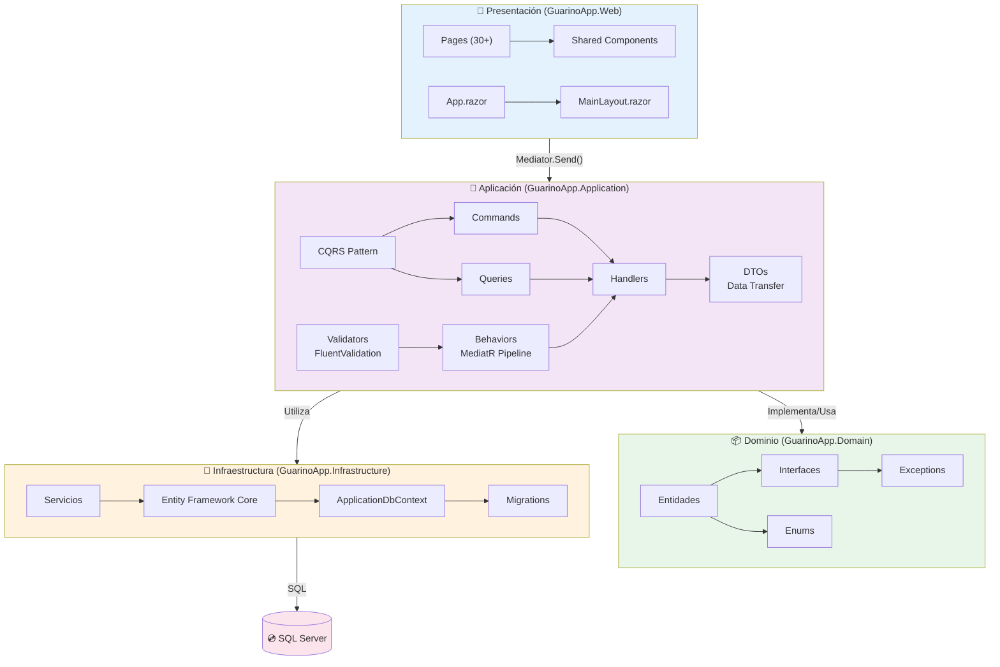
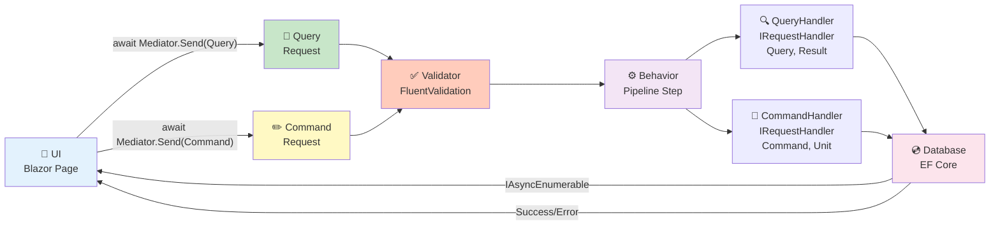
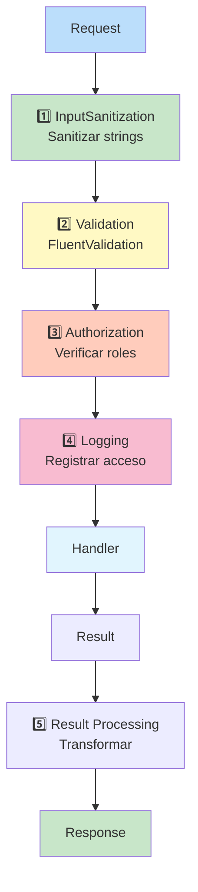
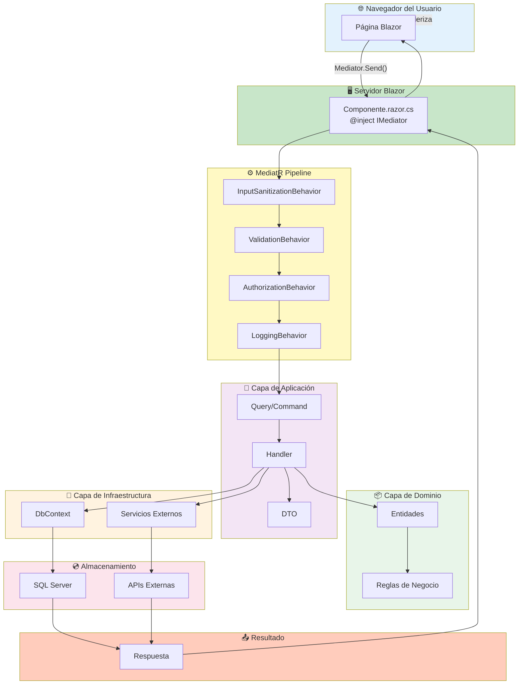

# 🔧 Servicios y Arquitectura Técnica - GuarinoApp

## Índice
1. [Capas y Responsabilidades](#capas-y-responsabilidades)
2. [Servicios de Dominio](#servicios-de-dominio)
3. [Servicios de Aplicación](#servicios-de-aplicación)
4. [Repositorios y Acceso a Datos](#repositorios-y-acceso-a-datos)
5. [CQRS y MediatR](#cqrs-y-mediatr)
6. [Comportamientos de Pipeline](#comportamientos-de-pipeline)
7. [Configuración y Validación](#configuración-y-validación)
8. [Diagrama de Integración Completa](#diagrama-de-integración-completa)

---

## Capas y Responsabilidades

### Arquitectura de Capas - Vista Detallada



### Responsabilidades por Capa

| Capa | Responsabilidad | Ejemplos |
|------|-----------------|----------|
| **Presentación** | Renderizar UI, Capturar entrada, Mostrar resultados | Pages, Components, Blazor |
| **Aplicación** | Lógica de negocio, Validación, Orquestación | Queries, Commands, Handlers |
| **Dominio** | Reglas de negocio puras, Entidades | AppUser, Pallet, Stock |
| **Infraestructura** | Acceso a datos, Servicios externos | EF Core, Repositories, APIs |

---

## Servicios de Dominio

### 1. IClimateService

**Responsabilidad**: Consultar datos climáticos en tiempo real

```csharp
// GuarinoApp.Application/Common/Interfaces/IClimateService.cs
public interface IClimateService
{
    Task<WeatherData> GetCurrentWeatherAsync(double latitude, double longitude);
    Task<WeatherForecast> GetForecastAsync(double latitude, double longitude, int days);
    Task<WeatherHistory> GetHistoricalDataAsync(double latitude, double longitude, DateTime startDate);
}

// Implementación: OpenMeteoClimateService
public class OpenMeteoClimateService : IClimateService
{
    private readonly HttpClient _httpClient;
    private readonly ILogger<OpenMeteoClimateService> _logger;

    public async Task<WeatherData> GetCurrentWeatherAsync(double latitude, double longitude)
    {
        var url = $"https://api.open-meteo.com/v1/forecast" +
            $"?latitude={latitude}&longitude={longitude}" +
            $"&current=temperature_2m,relative_humidity_2m,precipitation";

        var response = await _httpClient.GetAsync(url);
        response.EnsureSuccessStatusCode();

        var json = await response.Content.ReadAsStringAsync();
        var data = JsonConvert.DeserializeObject<WeatherData>(json);

        _logger.LogInformation("Weather data retrieved for {Latitude}, {Longitude}", 
            latitude, longitude);

        return data;
    }
}
```

**Ubicación**: `GuarinoApp.Application/Common/Interfaces/IClimateService.cs`  
**Implementación**: `GuarinoApp.Infrastructure/Services/OpenMeteoClimateService.cs`  
**Inyección**: Scoped en Program.cs  
**Timeout**: Configurable, mínimo 300 segundos

---

### 2. IClimateRiskService

**Responsabilidad**: Evaluar riesgos climáticos basados en datos meteorológicos

```csharp
public interface IClimateRiskService
{
    Task<ClimateRiskAssessment> EvaluateRisksAsync(WeatherData weather);
    Task<List<MitigationPlan>> GenerateMitigationPlansAsync(ClimateRiskAssessment risk);
}

public class ClimateRiskService : IClimateRiskService
{
    private readonly IClimateService _climateService;
    private readonly IApplicationDbContext _context;
    private readonly ClimateRiskSettings _settings;

    public async Task<ClimateRiskAssessment> EvaluateRisksAsync(WeatherData weather)
    {
        var assessment = new ClimateRiskAssessment();

        // Evaluar cada riesgo
        if (weather.Temperature > _settings.TemperatureThresholdCelsius)
            assessment.Risks.Add(new RiskFactor 
            { 
                Type = RiskType.HighTemperature, 
                Severity = CalculateSeverity(weather.Temperature) 
            });

        if (weather.Humidity < _settings.HumidityThresholdPercent)
            assessment.Risks.Add(new RiskFactor 
            { 
                Type = RiskType.LowHumidity, 
                Severity = CalculateSeverity(weather.Humidity) 
            });

        // Guardar en BD
        var evento = new EventoClimaticoDto 
        { 
            Fecha = DateTime.UtcNow,
            Tipo = assessment.RiskLevel.ToString(),
            Intensidad = assessment.OverallScore
        };

        _context.EventosClimaticos.Add(evento);
        await _context.SaveChangesAsync();

        return assessment;
    }
}
```

**Ubicación**: `GuarinoApp.Application/Common/Interfaces/IClimateRiskService.cs`  
**Implementación**: `GuarinoApp.Infrastructure/Services/ClimateRiskService.cs`  
**Uso**: ClimateMonitoringHostedService, ProyeccionZafra

---

### 3. ClimateMonitoringHostedService

**Responsabilidad**: Monitoreo periódico de riesgos climáticos

```csharp
public class ClimateMonitoringHostedService : BackgroundService
{
    private readonly IServiceProvider _serviceProvider;
    private readonly ILogger<ClimateMonitoringHostedService> _logger;
    private readonly ClimateRiskSettings _settings;
    private Timer _timer;

    protected override async Task ExecuteAsync(CancellationToken stoppingToken)
    {
        _logger.LogInformation("Climate Monitoring Service started");

        // Ejecutar inmediatamente
        await DoWorkAsync(stoppingToken);

        // Luego ejecutar cada CheckIntervalMinutes
        _timer = new Timer(
            callback: _ => DoWorkAsync(stoppingToken).Wait(),
            state: null,
            dueTime: TimeSpan.FromMinutes(_settings.CheckIntervalMinutes),
            period: TimeSpan.FromMinutes(_settings.CheckIntervalMinutes)
        );

        await Task.CompletedTask;
    }

    private async Task DoWorkAsync(CancellationToken ct)
    {
        using (var scope = _serviceProvider.CreateScope())
        {
            var climateService = scope.ServiceProvider.GetRequiredService<IClimateService>();
            var riskService = scope.ServiceProvider.GetRequiredService<IClimateRiskService>();

            try
            {
                // Obtener coordenadas de cultivos (hardcoded o de BD)
                var locations = new List<(double lat, double lon, string name)>
                {
                    (-33.8688, -56.1645, "Finca Principal")
                };

                foreach (var (lat, lon, name) in locations)
                {
                    var weather = await climateService.GetCurrentWeatherAsync(lat, lon);
                    var assessment = await riskService.EvaluateRisksAsync(weather);

                    if (assessment.RiskLevel == RiskLevel.High)
                        _logger.LogWarning("HIGH RISK detected at {Location}: {Risk}", 
                            name, assessment.OverallScore);
                }
            }
            catch (Exception ex)
            {
                _logger.LogError(ex, "Error in climate monitoring");
            }
        }
    }

    public override async Task StopAsync(CancellationToken stoppingToken)
    {
        _timer?.Dispose();
        await base.StopAsync(stoppingToken);
    }
}
```

**Ubicación**: `GuarinoApp.Infrastructure/Services/ClimateMonitoringHostedService.cs`  
**Ejecución**: Automática al iniciar aplicación  
**Intervalo**: Configurable en appsettings (defecto: 60 minutos)

---

## Servicios de Aplicación

### 1. IExportService

**Responsabilidad**: Exportar datos a Excel y PDF

```csharp
public interface IExportService
{
    Task<byte[]> ExportToExcelAsync<T>(
        IEnumerable<T> data, 
        string sheetName = "Sheet1") where T : class;

    Task<byte[]> ExportToPdfAsync<T>(
        IEnumerable<T> data, 
        string title) where T : class;
}

// Implementación simplificada
public class ExportService : IExportService
{
    private readonly ILogger<ExportService> _logger;

    public async Task<byte[]> ExportToExcelAsync<T>(
        IEnumerable<T> data, 
        string sheetName = "Sheet1") where T : class
    {
        var workbook = new XLWorkbook();
        var worksheet = workbook.Worksheets.Add(sheetName);

        var properties = typeof(T).GetProperties();

        // Escribir encabezados
        for (int i = 0; i < properties.Length; i++)
        {
            worksheet.Cell(1, i + 1).Value = properties[i].Name;
            worksheet.Cell(1, i + 1).Style.Font.Bold = true;
        }

        // Escribir datos
        var row = 2;
        foreach (var item in data)
        {
            for (int i = 0; i < properties.Length; i++)
            {
                var value = properties[i].GetValue(item);
                worksheet.Cell(row, i + 1).Value = value?.ToString() ?? "";
            }
            row++;
        }

        // Ajustar ancho de columnas
        worksheet.Columns().AdjustToContents();

        // Convertir a bytes
        using (var ms = new MemoryStream())
        {
            workbook.SaveAs(ms);
            return ms.ToArray();
        }
    }
}
```

**Ubicación**: `GuarinoApp.Infrastructure/Services/ExportService.cs`  
**Librería**: ClosedXML (Excel), iTextSharp (PDF)  
**Inyección**: Singleton en Program.cs

---

### 2. IEmailService

**Responsabilidad**: Envío de correos electrónicos

```csharp
public interface IEmailService
{
    Task SendEmailAsync(EmailRequest request);
    Task SendEmailWithAttachmentAsync(EmailRequest request, byte[] attachment, string fileName);
}

public class EmailService : IEmailService
{
    private readonly EmailOptions _options;
    private readonly ILogger<EmailService> _logger;

    public async Task SendEmailAsync(EmailRequest request)
    {
        using (var smtpClient = new SmtpClient(_options.SmtpServer, _options.SmtpPort))
        {
            smtpClient.Credentials = new NetworkCredential(
                _options.Username, 
                _options.Password);
            smtpClient.EnableSsl = true;

            var mailMessage = new MailMessage(
                _options.FromEmail,
                request.To,
                request.Subject,
                request.Body)
            {
                IsBodyHtml = true
            };

            try
            {
                await smtpClient.SendMailAsync(mailMessage);
                _logger.LogInformation("Email sent to {To}", request.To);
            }
            catch (Exception ex)
            {
                _logger.LogError(ex, "Failed to send email to {To}", request.To);
                throw;
            }
        }
    }
}
```

**Ubicación**: `GuarinoApp.Infrastructure/Services/EmailService.cs`  
**Configuración**: appsettings.EmailOptions  
**Uso**: Notificaciones, reportes, alertas

---

### 3. IAIService

**Responsabilidad**: Integración con Ollama para análisis IA

```csharp
public interface IAIService
{
    Task<string> GenerateAnalysisAsync(string prompt);
    Task<ZafraStrategyResultDto> AnalyzeCropStrategyAsync(ProjectionData data);
}

public class OllamaAIService : IAIService
{
    private readonly HttpClient _httpClient;
    private readonly IPromptProvider _promptProvider;
    private readonly OllamaOptions _options;

    public async Task<string> GenerateAnalysisAsync(string prompt)
    {
        var request = new OllamaRequest
        {
            Model = _options.Model,
            Prompt = prompt,
            Stream = false
        };

        var response = await _httpClient.PostAsJsonAsync(
            $"{_options.Url}/api/generate", 
            request);

        var result = await response.Content.ReadAsAsync<OllamaResponse>();
        return result.Response;
    }

    public async Task<ZafraStrategyResultDto> AnalyzeCropStrategyAsync(ProjectionData data)
    {
        var prompt = _promptProvider.GetZafraStrategyPrompt(data);
        var aiResponse = await GenerateAnalysisAsync(prompt);

        // Parsear respuesta IA
        var strategy = ParseStrategy(aiResponse);
        return strategy;
    }
}
```

**Ubicación**: `GuarinoApp.Infrastructure/Services/OllamaAIService.cs`  
**Configuración**: appsettings.OllamaOptions  
**Timeout**: Mínimo 300 segundos (cold start de modelo)

---

## Repositorios y Acceso a Datos

### Patrón Repository con EF Core

```csharp
// Interfaz genérica
public interface IRepository<T> where T : class
{
    IQueryable<T> GetAll();
    Task<T> GetByIdAsync(int id);
    Task<T> AddAsync(T entity);
    Task UpdateAsync(T entity);
    Task DeleteAsync(T entity);
    Task<int> SaveChangesAsync();
}

// Implementación
public class Repository<T> : IRepository<T> where T : class
{
    protected readonly IApplicationDbContext _context;
    protected readonly DbSet<T> _dbSet;

    public Repository(IApplicationDbContext context)
    {
        _context = context;
        _dbSet = context.Set<T>();
    }

    public IQueryable<T> GetAll() => _dbSet.AsNoTracking();

    public async Task<T> GetByIdAsync(int id) 
        => await _dbSet.FindAsync(id);

    public async Task<T> AddAsync(T entity)
    {
        _dbSet.Add(entity);
        return entity;
    }
}

// Uso en Handler
public class GetPalletsQueryHandler : IRequestHandler<GetPalletsQuery, List<PalletDto>>
{
    private readonly IApplicationDbContext _context;

    public async Task<List<PalletDto>> Handle(GetPalletsQuery request, CancellationToken ct)
    {
        var pallets = await _context.Pallets
            .Where(p => string.IsNullOrEmpty(request.Numero) || 
                   p.Numero.Contains(request.Numero))
            .Select(p => new PalletDto
            {
                Id = p.Id,
                Numero = p.Numero,
                Peso = p.Peso,
                FechaCreacion = p.FechaCreacion
            })
            .ToListAsync(ct);

        return pallets;
    }
}
```

**AsNoTracking()**: Optimización para queries de lectura  
**SaveChangesAsync()**: Persiste cambios en BD  
**Nota**: EF Core + Blazor Server = automático DbContext tracking

---

## CQRS y MediatR

### Flujo CQRS Completo



### Ejemplo: Query + Handler

```csharp
// 1. Query (Request)
public record GetPalletsQuery(
    string? Numero = null,
    string? Cliente = null,
    int Skip = 0,
    int Take = 10) : IRequest<List<PalletDto>>;

// 2. Handler
public class GetPalletsQueryHandler 
    : IRequestHandler<GetPalletsQuery, List<PalletDto>>
{
    private readonly IApplicationDbContext _context;
    private readonly ICurrentUserService _currentUser;
    private readonly ILogger<GetPalletsQueryHandler> _logger;

    public async Task<List<PalletDto>> Handle(
        GetPalletsQuery request, 
        CancellationToken cancellationToken)
    {
        // 1. Autorización (opcional, aquí o en Behavior)
        if (!_currentUser.IsInRole("Operador"))
            throw new UnauthorizedAccessException();

        // 2. Validación de datos
        if (request.Take > 1000)
            throw new ArgumentException("Take cannot exceed 1000");

        // 3. Query a BD
        var query = _context.Pallets.AsNoTracking();

        if (!string.IsNullOrEmpty(request.Numero))
            query = query.Where(p => p.Numero.Contains(request.Numero));

        if (!string.IsNullOrEmpty(request.Cliente))
            query = query.Where(p => p.Cliente == request.Cliente);

        var pallets = await query
            .Skip(request.Skip)
            .Take(request.Take)
            .Select(p => new PalletDto
            {
                Id = p.Id,
                Numero = p.Numero,
                Cliente = p.Cliente,
                Peso = p.Peso,
                FechaCreacion = p.FechaCreacion
            })
            .ToListAsync(cancellationToken);

        // 4. Loguear (auditoría)
        _logger.LogInformation(
            "User {UserId} queried {Count} pallets", 
            _currentUser.UserId, 
            pallets.Count);

        return pallets;
    }
}

// 3. Uso en Blazor Page
@inject IMediator Mediator

@code {
    private List<PalletDto> pallets;

    protected override async Task OnInitializedAsync()
    {
        var query = new GetPalletsQuery(Skip: 0, Take: 10);
        pallets = await Mediator.Send(query);
    }
}
```

---

## Comportamientos de Pipeline

### MediatR Behaviors (Middleware del CQRS)



### Implementación de Behavior

```csharp
// InputSanitizationBehavior
public class InputSanitizationBehavior<TRequest, TResponse>
    : IPipelineBehavior<TRequest, TResponse>
    where TRequest : notnull
{
    public async Task<TResponse> Handle(
        TRequest request,
        RequestHandlerDelegate<TResponse> next,
        CancellationToken ct)
    {
        // Sanitizar propiedades string del request
        SanitizeRequest(request);

        return await next();
    }

    private void SanitizeRequest(TRequest request)
    {
        var properties = request.GetType()
            .GetProperties()
            .Where(p => p.PropertyType == typeof(string));

        foreach (var property in properties)
        {
            var value = property.GetValue(request) as string;
            if (value != null)
            {
                var sanitized = InputSanitizer.Sanitize(value);
                property.SetValue(request, sanitized);
            }
        }
    }
}

// ValidationBehavior
public class ValidationBehavior<TRequest, TResponse>
    : IPipelineBehavior<TRequest, TResponse>
    where TRequest : notnull
{
    private readonly IEnumerable<IValidator<TRequest>> _validators;

    public async Task<TResponse> Handle(
        TRequest request,
        RequestHandlerDelegate<TResponse> next,
        CancellationToken ct)
    {
        if (!_validators.Any())
            return await next();

        var context = new ValidationContext<TRequest>(request);
        var validationResults = await Task.WhenAll(
            _validators.Select(v => v.ValidateAsync(context, ct))
        );

        var failures = validationResults
            .Where(r => r.Errors.Any())
            .SelectMany(r => r.Errors)
            .ToList();

        if (failures.Any())
            throw new ValidationException(failures);

        return await next();
    }
}

// Registro en Program.cs
builder.Services.AddMediatR(config =>
{
    config.RegisterServicesFromAssemblies(
        typeof(Program).Assembly,
        typeof(IApplicationDbContext).Assembly
    );

    // Registrar behaviors
    config.AddOpenBehavior(typeof(InputSanitizationBehavior<,>));
    config.AddOpenBehavior(typeof(ValidationBehavior<,>));
});
```

---

## Configuración y Validación

### Configuración por Opciones

```csharp
// Program.cs - Validar en startup
builder.Services
    .AddOptions<ClimateRiskSettings>()
    .Bind(builder.Configuration.GetSection(
        ClimateRiskSettings.SectionName))
    .ValidateDataAnnotations()
    .ValidateOnStart();

// Usar en inyección
public class ClimateMonitoringHostedService : BackgroundService
{
    private readonly IOptions<ClimateRiskSettings> _options;

    public ClimateMonitoringHostedService(
        IOptions<ClimateRiskSettings> options)
    {
        _options = options;
    }

    protected override async Task ExecuteAsync(CancellationToken stoppingToken)
    {
        // Usar: _options.Value.CheckIntervalMinutes
    }
}
```

### Validadores FluentValidation

```csharp
public class CreateUserCommandValidator 
    : AbstractValidator<CreateUserCommand>
{
    public CreateUserCommandValidator()
    {
        RuleFor(x => x.Email)
            .NotEmpty()
                .WithMessage("Email requerido")
            .EmailAddress()
                .WithMessage("Email inválido")
            .MaximumLength(255)
                .WithMessage("Email no puede exceder 255 caracteres");

        RuleFor(x => x.Password)
            .NotEmpty()
                .WithMessage("Contraseña requerida")
            .MinimumLength(8)
                .WithMessage("Mínimo 8 caracteres")
            .Matches(@"[A-Z]")
                .WithMessage("Debe contener mayúscula")
            .Matches(@"[0-9]")
                .WithMessage("Debe contener número");

        RuleFor(x => x.Roles)
            .NotEmpty()
                .WithMessage("Al menos 1 rol requerido")
            .Must(r => r.All(ro => IsValidRole(ro)))
                .WithMessage("Rol inválido");
    }

    private bool IsValidRole(string role) 
        => new[] { "Admin", "Gerencia", "Contador", "Operador" }
            .Contains(role);
}
```

---

## Diagrama de Integración Completa



---

## Tabla Resumen de Servicios

| Servicio | Interface | Implementación | Lifetime | Uso |
|----------|-----------|-----------------|----------|-----|
| **ClimateService** | IClimateService | OpenMeteoClimateService | Scoped | Consultar clima |
| **ClimateRiskService** | IClimateRiskService | ClimateRiskService | Scoped | Evaluar riesgos |
| **ExportService** | IExportService | ExportService | Singleton | Exportar datos |
| **EmailService** | IEmailService | EmailService | Scoped | Enviar emails |
| **AIService** | IAIService | OllamaAIService | Scoped | Análisis IA |
| **AuditService** | IAuditService | AuditService | Scoped | Auditoría |
| **AuthService** | IAuthorizationService | AuthService | Scoped | Autorización |

---

**Última actualización**: 2024-01-XX  
**Versión**: 1.0
