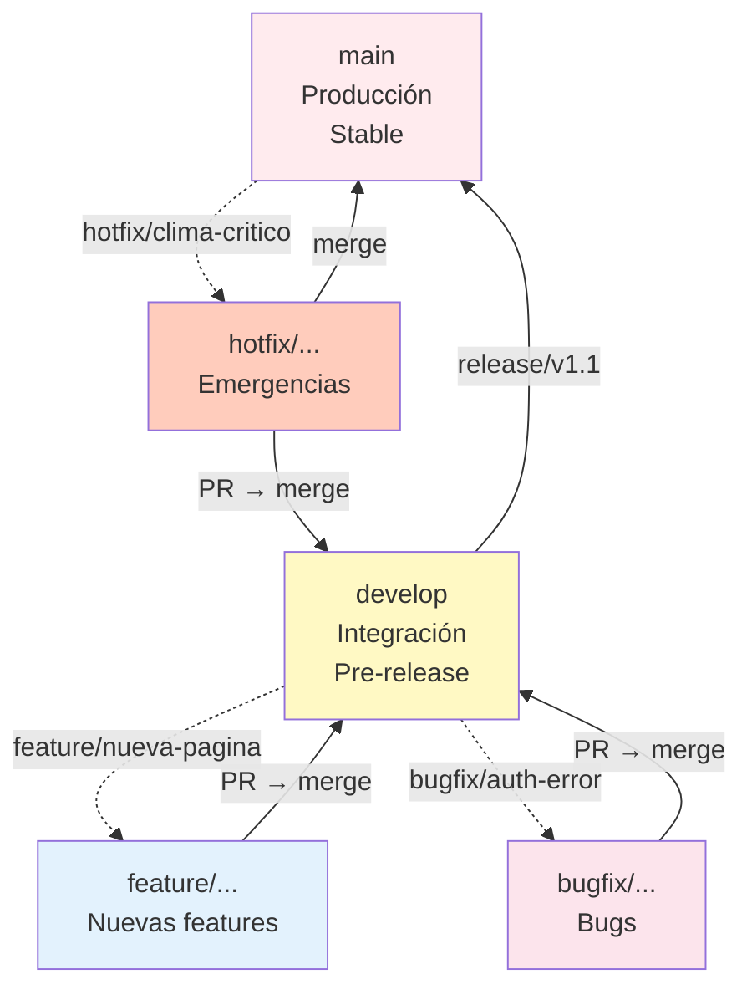

# 🔄 Workflow de Desarrollo - Guía de Contribución

## Índice
1. [Configuración Inicial](#configuración-inicial)
2. [Branches y Naming](#branches-y-naming)
3. [Proceso de Desarrollo](#proceso-de-desarrollo)
4. [Pull Requests](#pull-requests)
5. [Merges y Conflictos](#merges-y-conflictos)
6. [Releases](#releases)
7. [Troubleshooting Git](#troubleshooting-git)

---

## Configuración Inicial

### 1. Clonar Repositorio

```bash
# Clonar por HTTPS (si no tienes SSH)
git clone https://github.com/adrian-silva-uy/guarino.git
cd guarino

# O por SSH (si tienes clave SSH configurada)
git clone git@github.com:adrian-silva-uy/guarino.git
cd guarino

# Verificar origen
git remote -v
# Output:
# origin  https://github.com/adrian-silva-uy/guarino.git (fetch)
# origin  https://github.com/adrian-silva-uy/guarino.git (push)
```

### 2. Configurar Identidad Git

```bash
# Configurar globalmente (en tu máquina)
git config --global user.name "Tu Nombre"
git config --global user.email "tu.email@company.com"

# O solo para este repositorio
git config user.name "Tu Nombre"
git config user.email "tu.email@company.com"

# Verificar
git config --list | grep user
```

### 3. Configurar Credenciales

```bash
# Opción 1: Credential Helper (Windows)
git config --global credential.helper manager

# Opción 2: Token PAT (Personal Access Token)
# Generar en GitHub > Settings > Developer settings > Personal access tokens
# Usar como contraseña cuando git lo pida

# Opción 3: SSH
# ssh-keygen -t ed25519 -C "tu.email@company.com"
# Copiar public key a GitHub > SSH and GPG keys
# eval $(ssh-agent -s)
# ssh-add ~/.ssh/id_ed25519
```

### 4. Configurar Editor y Difftool

```bash
# Editor por defecto para commits
git config --global core.editor "code --wait"  # Visual Studio Code
git config --global core.editor "vim"          # Vim

# Visor de diferencias
git config --global merge.tool meld
git config --global diff.tool vimdiff
```

---

## Branches y Naming

### Estrategia Git Flow



### Convención de Nombres

```bash
# Feature (nueva funcionalidad)
git checkout -b feature/dashboard-ejecutivo
git checkout -b feature/modulo-facturacion
git checkout -b feature/integracion-openmeteo

# Bugfix (corrección de bug)
git checkout -b bugfix/auth-windows-fail
git checkout -b bugfix/export-excel-encoding
git checkout -b bugfix/clima-timeout

# Hotfix (arreglo urgente en producción)
git checkout -b hotfix/v1.0.1-seguridad-critica
git checkout -b hotfix/v1.0.1-db-connection

# Refactor (cambios en estructura)
git checkout -b refactor/limpiar-servicios
git checkout -b refactor/migrar-ef7

# Docs (actualización de documentación)
git checkout -b docs/wiki-arquitectura
git checkout -b docs/guia-despliegue

# Test (nuevos tests o mejoras)
git checkout -b test/cobertura-climatica
git checkout -b test/integracion-ollama

# Format
feature/<descripcion-breve-en-kebab-case>
bugfix/<descripcion-breve-en-kebab-case>
hotfix/v<version>-<descripcion>
```

---

## Proceso de Desarrollo

### Flujo Típico de Feature

```bash
# 1. Asegurar que develop está al día
git checkout develop
git pull origin develop

# 2. Crear rama de feature
git checkout -b feature/nueva-funcionalidad

# 3. Realizar cambios
# ... editar archivos ...

# 4. Ver estado
git status
# Changes not staged for commit:
#   GuarinoApp.Web/Pages/MiPagina.razor
#   GuarinoApp.Application/Modules/Mi/Queries/GetMi.cs

# 5. Stagear cambios
git add GuarinoApp.Web/Pages/MiPagina.razor
git add GuarinoApp.Application/Modules/Mi/Queries/GetMi.cs

# O stagear todo
git add .

# 6. Ver cambios a commitear
git diff --staged

# 7. Hacer commit con mensaje descriptivo
git commit -m "feat: agregar página Mi Módulo

- Crear MiPagina.razor con diseño base
- Implementar GetMiQuery y handler
- Agregar validaciones y tests

Closes #42"

# 8. Publicar rama en GitHub
git push -u origin feature/nueva-funcionalidad

# 9. Crear Pull Request en GitHub
# (Ver sección Pull Requests)
```

### Mensajes de Commit (Conventional Commits)

```
<type>(<scope>): <subject>

<body>

<footer>
```

**Types**:
- `feat:` - Nueva feature
- `fix:` - Corrección de bug
- `docs:` - Cambios en documentación
- `style:` - Formato, comillas, espacios (sin lógica)
- `refactor:` - Restructuración de código sin cambiar funcionalidad
- `perf:` - Mejoras de performance
- `test:` - Agregar o actualizar tests
- `chore:` - Actualizaciones de deps, build config

**Ejemplos**:

```bash
git commit -m "feat(climate): agregar monitoreo automático

Implementar ClimateMonitoringHostedService que ejecuta cada
1 hora y consulta OpenMeteo para evaluar riesgos climáticos.

- Servicio de background que consulta OpenMeteo
- Integración con ClimateRiskService
- Configuración en appsettings.json
- Tests unitarios incluidos

Closes #123"

git commit -m "fix(auth): corregir timeout de autenticación Windows

El auth fallaba con AD después de 30 segundos. Se aumentó el
timeout a 60 segundos y se agregó retry logic.

Closes #456"

git commit -m "docs: actualizar wiki de despliegue"

git commit -m "refactor(export): extraer lógica de Excel a servicio"

git commit -m "test: agregar cobertura para ExportService"
```

---

## Pull Requests

### Crear PR en GitHub

1. **Título claro y descriptivo**
   ```
   ✅ BUENO:
   "Agregar dashboard con KPIs de operación diaria"
   "Fix: corregir timeout de autenticación Windows"

   ❌ MALO:
   "Update"
   "Fix bug"
   "Mi cambio"
   ```

2. **Descripción con contexto**
   ```markdown
   ## Descripción
   Agregamos una nueva página de dashboard que muestra los KPIs
   principales de la operación diaria (stock, pallets, etc).

   ## Cambios
   - Nueva página Dashboard.razor
   - Servicio IDashboardDataService
   - Queries para KPIs
   - Tests unitarios

   ## Testing
   - ✅ Compilación exitosa
   - ✅ Tests locales pasados
   - ✅ Verificado en dev localmente

   ## Screenshots
   [Adjuntar imágenes si es UI]

   Closes #123
   ```

3. **Asignar revisor**
   - Al menos 1 revisor (preferiblemente 2 para cambios críticos)
   - Seleccionar persona con experiencia en el área

4. **Seleccionar etiquetas**
   - `enhancement` - Nueva feature
   - `bug` - Corrección
   - `documentation` - Docs
   - `security` - Cambio de seguridad
   - `breaking-change` - Cambio incompatible

### Checklist de PR

```markdown
## Pre-PR Checklist
- [ ] Código compilado sin warnings
- [ ] Tests unitarios pasados
- [ ] Cambios documentados en código
- [ ] Formato de código consistente
- [ ] No hay console.log() ni código muerto
- [ ] Mensajes de commit claros

## Post-PR Checklist
- [ ] Descripción clara del cambio
- [ ] Etiquetas agregadas
- [ ] Revisor/es asignados
- [ ] Vinculado a issue (#número)
```

### Proceso de Revisión

**Revisor hace**:
```bash
# 1. Descargar rama del PR
git fetch origin feature/nueva-funcionalidad
git checkout feature/nueva-funcionalidad

# 2. Compilar y testear localmente
dotnet build
dotnet test

# 3. Revisar cambios
git log develop..HEAD --oneline
git diff develop

# 4. Dejar comentarios en GitHub
# [En interfaz de GitHub]

# 5. Aprobar o solicitar cambios
```

**Autor responde**:
```bash
# Si hay cambios solicitados:
git add .
git commit -m "fix: incorporar feedback del review"
git push

# Después de aprobación: merge via GitHub UI
```

---

## Merges y Conflictos

### Merge Automático (sin conflictos)

```bash
# En GitHub: Click en "Merge pull request"
# Automáticamente se hace merge a develop
```

### Merge Manual (con conflictos)

```bash
# 1. Fetch latest changes
git fetch origin

# 2. Checkout develop
git checkout develop
git pull origin develop

# 3. Merge feature branch
git merge feature/nueva-funcionalidad

# Si hay conflictos: Git avisa
# CONFLICT (content merge): GuarinoApp.Web/Program.cs
# Auto-merging GuarinoApp.Web/Program.cs
# CONFLICT (content merge): GuarinoApp.Application/DependencyInjection.cs

# 4. Resolver conflictos (abrir archivos)
# <<<<<<< HEAD
#     // develop version
# =======
#     // feature version
# >>>>>>> feature/nueva-funcionalidad

# 5. Editar y resolver manualmente

# 6. Stagear y commitear
git add Program.cs
git add DependencyInjection.cs
git commit -m "chore: merge feature/nueva-funcionalidad"

# 7. Push
git push origin develop
```

### Rebase vs Merge

```bash
# MERGE (crea commit de merge, mantiene historia)
git merge feature/rama
# Pro: Mantiene historia completa
# Con: Historia más compleja

# REBASE (rebobina y aplica cambios, historia lineal)
git rebase develop
# Pro: Historia más limpia
# Con: Cambia commits, evitar en ramas públicas

# Recomendación: MERGE en develop, REBASE en feature local
```

---

## Releases

### Crear Release

```bash
# 1. En develop, verificar que todo está listo
git checkout develop
git pull origin develop

# 2. Crear rama de release
git checkout -b release/v1.1

# 3. Actualizar versión
# Archivo: GuarinoApp.Web/GuarinoApp.Web.csproj
<Version>1.1.0</Version>

# Archivo: docs/README.md
# **Versión de Aplicación Documentada**: GuarinoApp v1.1

# 4. Update CHANGELOG
# Crear file: CHANGELOG.md (o README.md)
"""
## [1.1.0] - 2024-01-XX

### Added
- Nueva página de Dashboard
- Integración OpenMeteo completa

### Fixed
- Bug de autenticación Windows
- Timeout de Ollama

### Changed
- Refactor de ExportService
"""

# 5. Commitear cambios
git commit -m "chore: bump version to 1.1.0"

# 6. Crear tag
git tag -a v1.1.0 -m "Release version 1.1.0"

# 7. Push release branch y tag
git push origin release/v1.1
git push origin v1.1.0

# 8. En GitHub: Crear Pull Request release → main
# Merge en main

# 9. Merge back a develop
git checkout develop
git merge main
git push origin develop

# 10. En GitHub: Crear Release (o Deployment)
```

### Versionado Semántico

```
MAJOR.MINOR.PATCH

v1.0.0  - Primer release
v1.0.1  - Patch (bugfix)
v1.1.0  - Minor (feature)
v2.0.0  - Major (breaking change)
```

---

## Troubleshooting Git

### Problema: Cambios no guardados antes de checkout

```bash
# Error: Your local changes to ... would be overwritten
git stash  # Guardar cambios temporalmente
git checkout otra-rama
git stash pop  # Recuperar cambios en la otra rama
```

### Problema: Commit hecho en rama equivocada

```bash
# Hiciste commit en develop pero debe ir en feature/
# Opción 1: Mover commits
git log --oneline | head -5

git reset --soft HEAD~1  # Deshacer último commit (mantener cambios)
git checkout -b feature/correcta
git commit -m "feat: ..."  # Re-commitear en rama correcta

# Opción 2: Cherry-pick
git checkout feature/correcta
git cherry-pick <commit-hash>
git checkout develop
git reset --hard HEAD~1
```

### Problema: Merge conflict en archivo crítico

```bash
# Ver conflictos
git status

# Ver detalles
git diff

# Opción 1: Usar mergetool visual
git mergetool

# Opción 2: Abortar merge y resolver después
git merge --abort

# Opción 3: Preferir una versión
git checkout --theirs Program.cs  # Usar versión de rama que merzeas
git checkout --ours Program.cs     # Usar versión actual (HEAD)
```

### Problema: Push rechazado (historia divergente)

```bash
# Error: failed to push some refs
# Causa: develop remoto tiene commits que local no tiene

# Opción 1: Pull rebase (mejor)
git pull --rebase origin develop
git push

# Opción 2: Merge (menos ideal)
git pull origin develop
git push
```

### Problema: Quiero deshacer el último commit

```bash
# Si aún no hiciste push (commit local)
git reset --soft HEAD~1   # Deshacer, mantener cambios
git reset --hard HEAD~1   # Deshacer todo (cuidado!)

# Si ya hiciste push (commit público)
git revert <commit-hash>  # Crea commit que deshace el anterior
git push
```

### Problema: Perdí cambios, ¿cómo los recupero?

```bash
# Ver historial de cambios
git reflog

# Recuperar commits "perdidos"
git reset --hard <commit-hash>

# Si nada funciona: contactar admin repo
```

---

## Best Practices

### ✅ DO's

```bash
# 1. Hacer commits pequeños y atómicos
git commit -m "feat: agregar validación de email"  # BIEN
# vs
git commit -m "feat: agregar validación, fixes, refactor, docs"  # MAL

# 2. Pullear before pushing
git pull origin <rama>
git push origin <rama>

# 3. Usar branches para features
git checkout -b feature/mi-feature  # BIEN
git push en main  # MAL

# 4. Escribir buenos mensajes de commit
git commit -m "fix: corregir timeout auth

El servicio de auth fallaba tras 30s. Se aumentó
timeout a 60s en la sección Ollama.

Fixes #456"

# 5. Proteger main y develop
# GitHub: Settings > Branches > Branch protection rules
# - Require pull request reviews (2 approvals)
# - Dismiss stale PR approvals
# - Require status checks to pass
```

### ❌ DON'Ts

```bash
# 1. No commitear secrets
# Usar .gitignore para appsettings.Production.json
# Usar Secret Manager en dev

# 2. No editear historia pública
git rebase origin/develop  # En rama pública = MAL
git rebase develop         # En rama local = OK

# 3. No hacer merge con --force
git push --force  # Nunca!

# 4. No commitear archivos generados
# .obj, .bin, .dll, bin/, obj/, node_modules/
# .gitignore debe excluirlos

# 5. No hacer commits grandes (>500 líneas)
# Dividir en commits lógicos más pequeños
```

---

## Recursos

### Cheat Sheet Git
```bash
# Principales comandos
git status                    # Ver estado
git add <archivo>            # Stagear cambio
git commit -m "msg"          # Commitear
git push                     # Publicar
git pull                     # Bajar cambios
git checkout -b <rama>       # Crear rama
git merge <rama>             # Mergear rama
git log --oneline            # Ver historia
git diff                     # Ver cambios
git stash                    # Guardar temp
```

### Links Útiles
- [GitHub Docs](https://docs.github.com)
- [Git Book](https://git-scm.com/book)
- [Conventional Commits](https://www.conventionalcommits.org)
- [Git Flow Cheatsheet](https://danielkummer.github.io/git-flow-cheatsheet)

---

**Última actualización**: 2024-01-XX  
**Versión**: 1.0
